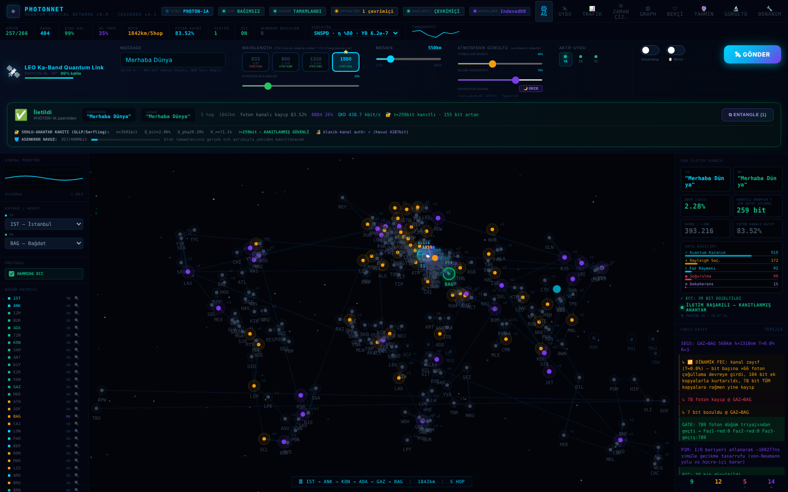
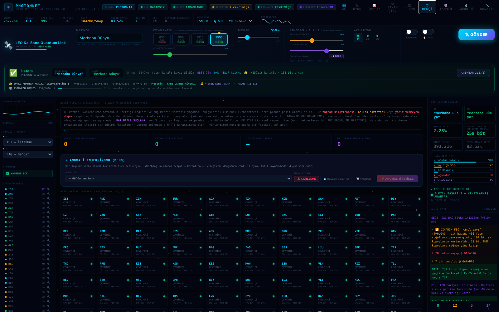
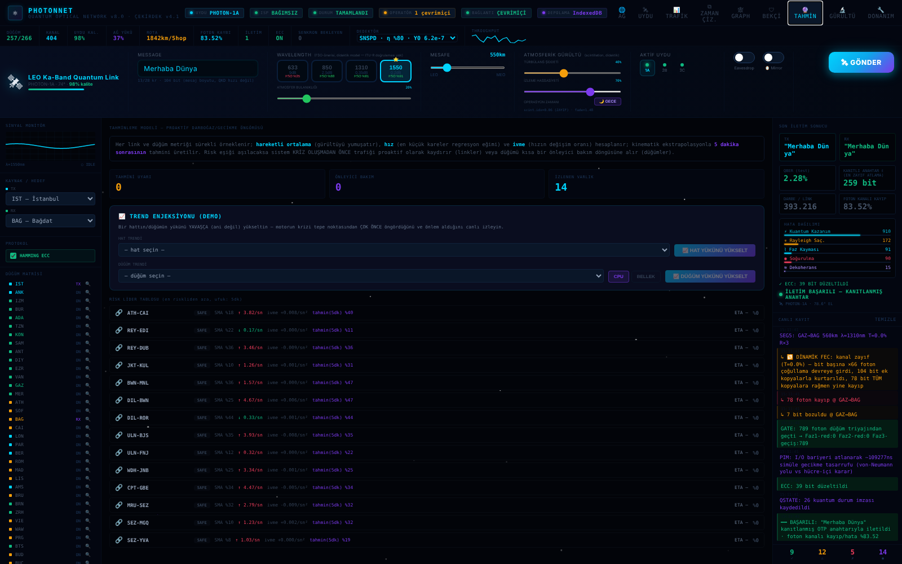
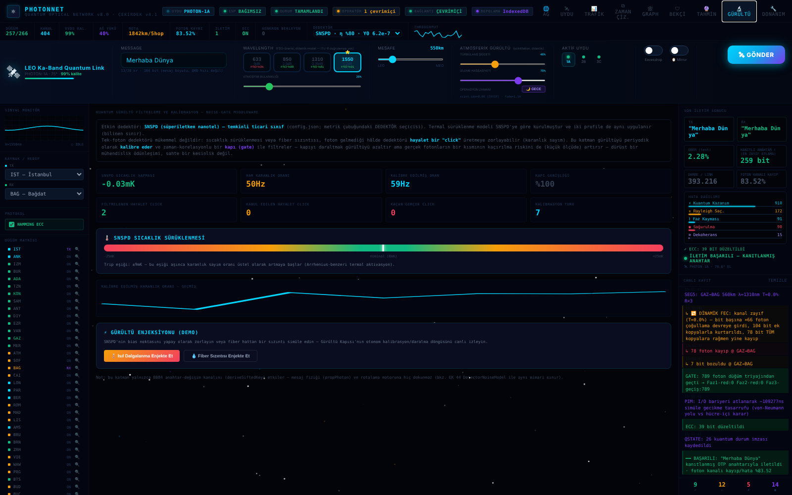
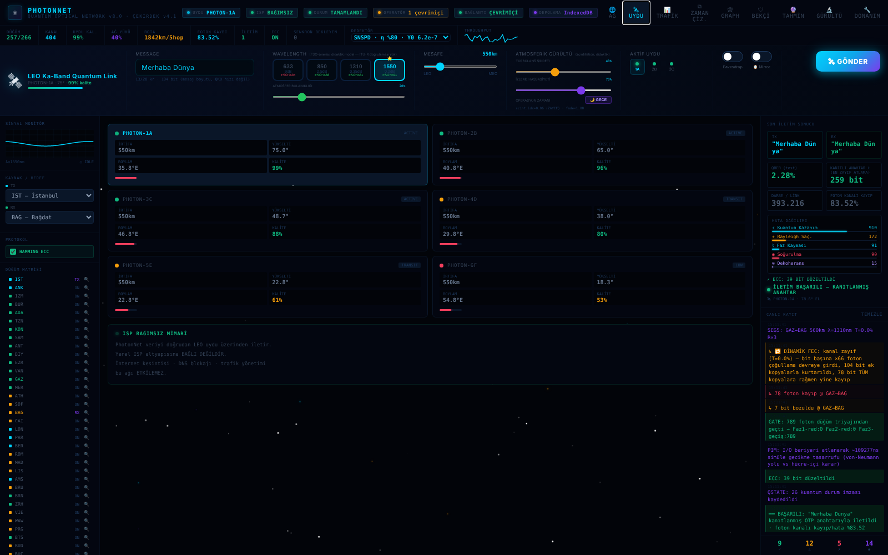

# PhotonNet — BB84 Quantum Key Distribution (QKD) Simulator and Production Layers

**photonicquantumcore** · core engine v4.1 · `npm test`: 100 self-tests (JavaScript + Python HAL) in CI

PhotonNet simulates an end-to-end QKD network on a classical computer and wraps the simulation in the
software a real deployment needs. It consists of:

- a React-based physics/cryptography core (`PhotonNet2.jsx` → `bb84/photonnet_core.js`) that runs BB84
  (with supporting E91/BBM92) over a ~270-node world topology with trusted-node relays;
- dozens of bridge/layer modules built **without modifying the core**: realistic hardware noise models,
  routing and entanglement logic, attack and stress drills;
- an ETSI GS QKD 014 key management entity (KME) server with mTLS, a PKI with OCSP/CRL revocation and an
  optional SoftHSM2/PKCS#11 back end;
- a Python hardware abstraction layer (HAL) with time-tag correlation, detector profiles and an online
  QRNG health gate (NIST SP 800-90B–style RCT/APT).

## Overview

**What the key pipeline actually does.** Since core v2 the quantum channel carries only key material:
Alice's raw bits come from an independent entropy source, rounds of pulses accumulate a sifted key, a
random test subset is disclosed for parameter estimation (abort at QBER_test ≥ 11 %), Cascade
reconciliation measures the real leakage, a two-parameter Serfling/GLLP finite-key bound gives the secure
length ℓ, and Toeplitz hashing performs privacy amplification. The message is then one-time-pad encrypted
and sent over the authenticated classical channel. On a trusted-node chain **every hop** runs its own
parameter estimation, reconciliation, ℓ and privacy amplification, and the end-to-end key is genuinely
relayed with public XOR announcements (core v4).

**Engineering discipline.** The core is extracted from the application source by a script and pinned by
SHA-256 in the tests; every core version is recorded in
[`bb84/docs/CORE_CHANGELOG.md`](bb84/docs/CORE_CHANGELOG.md). Components fail closed: a missing entropy
source, an unhealthy QRNG batch, a revoked certificate or an unknown detector profile stops the
operation instead of falling back silently. Almost every file states what it does **not** do
("honesty note" / "scope note"); this README follows the same rule.

**What it is not.** It is a simulation and an integration stack, not a QKD device. There is no photonic
hardware and no certified QRNG; entropy comes from the platform CSPRNG, so security is computational, not
information-theoretic. Physical parameters are literature values or assumptions, not measurements of a
specific device, and the model has not yet been validated against a published experiment. See
[§1](#1-what-this-project-is--and-what-it-is-not).

**How it compares** with NetSquid, SeQUeNCe, QuNetSim and QKDNetSim:
[`docs/COMPARISON.md`](docs/COMPARISON.md).

**Quick start**

```bash
npm install && pip install -r hal/requirements.txt
npm test                     # all self-tests (~18 min); npm run test:fast skips the long ones
open PhotonNet.html          # the full application, single file, no server needed
```

### Screenshots

All images are generated from the current `PhotonNet.html` by `node bb84/tools/capture_screenshots.js`
(no hand-made screenshots are kept; the script writes nothing if the default transmission does not succeed).
The user interface itself is in Turkish.


*Default IST → BAG transmission: on the trusted-node chain every hop produces its own finite-key proof;
the card shows ℓ of the weakest hop and the key left over after the one-time pad.*

| | |
|---|---|
|  |  |
| Node watchdog grid | Proactive bottleneck prediction |
|  |  |
| Detector noise calibration (config.json profile) | LEO satellite constellation |

---

## Contents

1. [What this project is — and what it is not](#1-what-this-project-is--and-what-it-is-not)
2. [Architecture: core + read-only layer pattern](#2-architecture-core--read-only-layer-pattern)
3. [Core engine (`photonnet_core.js`) contents](#3-core-engine-photonnet_corejs-contents)
4. [Module inventory — by category, all files](#4-module-inventory--by-category-all-files)
   - 4.1 [Physical layer / timing / hardware realism](#41-physical-layer--timing--hardware-realism)
   - 4.2 [Network / routing / entanglement layer](#42-network--routing--entanglement-layer)
   - 4.3 [Security / protocol / ETSI-014 / PKI layer](#43-security--protocol--etsi-014--pki-layer)
   - 4.4 [Attack / stress / adversarial test layer](#44-attack--stress--adversarial-test-layer)
   - 4.5 [Tools, build, CI/CD](#45-tools-build-cicd)
   - 4.6 [HAL — Python hardware abstraction layer](#46-hal--python-hardware-abstraction-layer)
   - 4.7 [Chart generators (`gen_*.js`)](#47-chart-generators-gen_js)
   - 4.8 [Root-level application files](#48-root-level-application-files)
5. [Engineering and test culture — recurring patterns](#5-engineering-and-test-culture--recurring-patterns)
6. [IBM ETSI-014 certification audit — summary verdict](#6-ibm-etsi-014-certification-audit--summary-verdict)
7. [Production readiness (PKI/mTLS/HSM)](#7-production-readiness-pkimtlshsm)
8. [Follow-up work — input validation and chaos engineering rounds 3 to 9](#8-follow-up-work--input-validation-and-chaos-engineering-rounds-3-to-9)
9. [How to run](#9-how-to-run)
10. [Directory map](#10-directory-map)
11. [License](#11-license)

Most source comments, test output and supporting documents under `bb84/docs/` are written in Turkish.

---

## 1. What this project is — and what it is not

**What it does:** PhotonNet is a **classical-computer simulation** of single-photon BB84/E91/BBM92
protocols, calibrated with real physical constants (fibre attenuation coefficients, detector dark-count
rates, timing jitter, electromagnetic shielding theory, etc.). It includes real fibre length/loss sweeps,
realistic Cascade/LDPC error correction, Toeplitz universal-hash privacy amplification, a Serfling/GLLP
finite-key security proof, and a **real** ETSI GS QKD 014 REST server (with mTLS) — keys produced through
this server can actually be delivered to other systems (for example a VPN/TLS tunnel).

**What it is NOT — critical honesty note:** there is no photonic hardware and no quantum random number
generator (QRNG). The audit in `bb84/IBM_ONAY_MATEMATIKSEL_DENETIM.md` showed that, before core v2, the
"quantum" bit stream was fully deterministic, derived from a single 32-bit `mulberry32` PRNG seed
(`entanglementSeed`). A 2³² seed space can be brute-forced in hours on modern hardware, which violates the
"Eve has no prior knowledge of the measurement outcomes" assumption on which the GLLP/Serfling proof rests.
Since core v2 ([`CORE_CHANGELOG.md`](bb84/docs/CORE_CHANGELOG.md)) Alice's raw bits come from an
independent entropy source (`crypto.getRandomValues` in the browser, `crypto.randomBytes` in Node) and the
key is never stretched with a PRNG; `mulberry32` is still used, seeded from that entropy, for simulated
channel noise. This removes the 2³² brute-force attack, but the entropy is a CSPRNG, not quantum
randomness: the **engineering** (Serfling/GLLP formulas, Cascade/LDPC, Toeplitz hashing, the n/k split) is
implemented consistently with the literature, but an **information-theoretic** security claim requires a
certified hardware QRNG and real optics. The HAL defines the QRNG interface for that hardware
([§4.6](#46-hal--python-hardware-abstraction-layer)); see also
[§6](#6-ibm-etsi-014-certification-audit--summary-verdict).

---

## 2. Architecture: core + read-only layer pattern

```
PhotonNet2.jsx  (~15,000 lines — the COMPLETE source of the React application,
                 UI and algorithms interleaved)
       │
       │  bb84/tools/extract_core.js  (TypeScript transpileModule turns JSX into
       │  React.createElement and replaces React with a shim object — the UI tree
       │  is never rendered; only algorithm classes/functions become require()-able)
       ▼
bb84/photonnet_core.js  (~14,000 lines, 85 exported symbols — the "CORE",
                          never edited by hand; versions: bb84/docs/CORE_CHANGELOG.md)
       │
       │  EVERY bridge/layer file in this repository only imports the core and
       │  calls it read-only — it never overwrites or patches it
       ▼
dozens of bridge modules (see §4) — physical realism, network/routing,
security/protocol, attack drills, tools
```

Concrete mechanisms that enforce this pattern:

- **SHA-256 integrity check**: almost every `_test.js`/drill file compares and reports the SHA-256 digest
  of `photonnet_core.js` (and, where relevant, of other read-only bridge files such as
  `timetag_acquisition_bridge.js`) before and after running — the claim "the core was not touched" is
  re-proven on every run, not assumed once. When the core deliberately moves to a new version (currently
  **v4.1**, SHA-256 `5c12cde3…676313`), the old/new hash and every changed function are documented in
  [`bb84/docs/CORE_CHANGELOG.md`](bb84/docs/CORE_CHANGELOG.md), and all pinned tests are updated to the new
  hash and re-run.
- **`extract_core.js --check`**: a CI gate — automatically verifies that `photonnet_core.js` is in sync
  with `PhotonNet2.jsx` (i.e. the source changed but the extraction was not regenerated and committed) and
  fails with exit code 1.
- **`EXPORT_MANIFEST`**: the exact list, defined in `extract_core.js`, of the 85 symbols expected to be
  exported from the core — if a new top-level symbol appears in the source (not yet in the manifest), the
  script reports it as INFORMATION but does not silently include it.

---

## 3. Core engine (`photonnet_core.js`) contents

The core contains the following real classes (full list, verified with `grep`):

**Physics / channel simulation:** `AtmosphericWindowModel`, `ScintillationEngine`,
`ScintillationModel`, `PointingBudget`, `DetectorNoiseModel`,
`OpticalPhaseLockedLoop`, `ChiralAcousticEngine`, `MemristorCell`

**BB84 protocol / security proof:** `QuantumKeyDistribution`,
`QKDSecurityProof`, `ParameterEstimationFilter`, `CascadeReconciliation`,
`LDPCReconciliation`, `ToeplitzAsyncEngine`, `OneTimePad`,
`ClassicalAuthChannel`, `ProductionSecurityAudit`, `SecureMessageSession`

**Network / routing / topology:** `NetworkTopology`, `NodeRegisterMatrix`,
`EdgeWeightPolicy`, `NodeTransitGate`, `LinkOutageController`,
`LinkGradedEavesdropThresholdAlgorithm`, `LinkRiskReputationEngine`,
`LEGADecisionCore`, `MinHeap` (for Dijkstra)

**Operations / capacity management:** `KeyPoolBuffer`, `KeyDeliveryStore`,
`CalibrationRateLimiter`, `NodeWatchdog`, `NoiseGateMiddleware`,
`NoiseMatrixCalibration`, `DualClockScheduler`, `SoftLandingFilter`,
`ChaosSuppressor`, `PredictiveCorridorEngine`, `PredictiveTelemetryEngine`,
`MetricTrendInjector`, `CoefficientEvolutionEngine`, `BurstTrafficGenerator`,
`InMemoryComputeFabric`

**UI components (React, not used by the layers):** `PhotonNet`
(main component), `Oscilloscope`, `BerGauge`, `Spark`, `LeoPanel`

**Key helper functions:** `mulberry32` (deterministic PRNG — used for simulated noise, see the honesty note
in §1), `combineSeed`, `dijkstra`, `routeCalculation` /
`routeCalculationResilient`, `bb84Reconcile`, `propPhoton` /
`propPhotonRelayChain`, `physicalSimulation`, `haversineKm`, `gaussianRandom`,
`poissonSample`, `shannonEntropy`, `toeplitzPackBits` / `toeplitzParity32`,
`otpEncryptBits` / `otpDecryptBits`, `deriveOtpKeyBits`, `t2b`/`b2t`
(bit↔text — 8-bit, may truncate Turkish characters; some layer files implement their own UTF-8-safe
versions).

Fibre attenuation coefficients for special wavelengths such as 633 nm were cross-checked against real
industry sources such as OZ Optics, Corning SMF-28 and FOA/EIA-TIA-568 (see the "DÜZELTME 15" comment at
the top of the file).

---

## 4. Module inventory — by category, all files

> Note: where a module has an **honesty/scope note**, it is stated separately — these notes are the most
> valuable form of documentation in this project and are deliberately not omitted.

### 4.1 Physical layer / timing / hardware realism

| File | What it does |
|---|---|
| `timetag_acquisition_bridge.js` | **Phase 1** — converts a raw picosecond time-tagged detector click stream (the format a real time-tagger would produce) into the format expected by the classical sifting layer. `TimeTagEmulator` models Bob's 4 detector channels (H/V/D/A) with detector efficiency, dark-count probability, Gaussian timing jitter (Box–Muller), dead time and optical misalignment. QBER_ABORT = 0.11. Basis/bit choices come from an injectable `qrng` interface backed by `crypto.randomBytes` — `mulberry32` is used ONLY for physical noise, NOT for key material. |
| `timetag_acquisition_test.js` | 7/7 self-tests: clean-line QBER stays at the optical-misalignment floor; QBER rises predictably with dark counts; widening the coincidence window trades yield↑ against QBER↑; an eavesdropper (Eve) is caught (QBER ~25 % → abort); 3 different randomness sources change QBER by < 0.6 % (QBER comes from physics, not from the RNG choice); sifted bits are packed correctly into the ETSI-014 format. |
| `timing_coincidence_engine.js` | **Phase 2** — models clock drift between Alice and Bob (the asymmetric synchronisation problem). `siftFixed()` (naive, fixed window) degrades under drift; `siftRecovered()` applies feed-forward correction with a Kalman filter (`JitterPredictor`); `bridgeClockJump()` bridges the transition window during sudden clock jumps with an ODLS (optical delay line). **Honesty note:** uncorrected clock drift looks like an eavesdropper (QBER jumps), but it is a SYNCHRONISATION problem — Kalman recovery NEVER masks a real eavesdropper (Eve's random-basis errors have no predictable structure). |
| `timing_coincidence_test.js` | 6/6 self-tests: perfect clock → baseline QBER/yield; uncorrected drift → QBER jump (the "diagnostic trap"); Kalman recovery → QBER/yield return to the physical floor; ODLS transition bridge → zero time-out drops; with recovery ON, a real eavesdropper is still caught (QBER > 20 %). |
| `detector_recalibration.js` | **Phase 3 (B4)** — adds real single-photon detector imperfections (afterpulsing, detector efficiency mismatch) and recalibrates the finite-key security proof accordingly. `qberByImperfection()` decomposes QBER into its components. Efficiency mismatch adds ~zero QBER but biases the sifted key and opens a side channel that the standard finite-key bound CANNOT SEE. `qberCliff()` finds the ℓ→0 security cliff by binary search. **Honesty note:** the idealised calibration was optimistic. |
| `detector_recalibration_test.js` | 6/6 self-tests: real imperfections raise QBER ×1.6+ above the idealised estimate; afterpulsing is the dominant component; feeding the real QBER into the finite-key proof lowers ℓ/n by > 5 points at n = 1e6 (still secure); efficiency mismatch creates a measurable side channel (must be monitored separately); the security margin under real QBER is narrower than the idealised one. |
| `shielded_detector_physics.js` | Propagates the clean environment of Faraday-cage shielding into the detector noise model — splits dark counts into THERMAL + EM components, recomputes the QBER floor and verifies the secret key rate (SKR) gain on the cleaned channel. **Critical honesty note:** the core's `DetectorNoiseModel` is calibrated for the SATELLITE (Micius) scenario (80 MHz gate); this project's own ground-based fibre BB84 (1 GHz gate) is a SEPARATE, differently calibrated scenario — the two CANNOT be used interchangeably (~2000× difference); the module reports both but always uses its own ground thermal reference as the operational baseline. |
| `shielded_detector_physics_test.js` | 5/5 self-tests: ground-based vs satellite-calibrated thermal references differ by ~2000× (reported as non-interchangeable); going from a dirty to a clean cage returns QBER exactly to the floor; SKR rises measurably on the clean channel; for every window multiplier the clean channel gives lower QBER than the dirty one. |
| `optical_delay_line.js` | **ODLS — L5.6** — while the Kalman filter converges (~9-step transition window), photons are held in a recirculating fibre loop + 2×2 switch instead of being dropped. Two INDEPENDENT, COMPETING budgets: (1) insertion loss (binding on the µs time scale) and (2) phase decoherence/T2 (binding on the ms time scale, for a real quantum memory). The `MEDIA` table compares media in dB per **time** (α·v) — chip waveguides look low in dB/m but are WORSE for storage because their GROUP VELOCITIES are much lower. **Honesty note:** "ODLS is NOT a free freezer" — it only works while both budgets are respected; the Kalman filter's FAST (µs) recovery is the physical PRE-CONDITION that keeps hold times within the 3 dB fibre-loss budget. |
| `optical_delay_line_test.js` | 6/6 self-tests: without ODLS the 9-step window drops 100 % of packets; with ODLS zero time-out drops; the µs fibre loop is loss-bound while a ms real quantum memory is phase-bound (two different physical regimes); fast (µs) recovery fits the budget, whereas slow (ms) reactive resynchronisation would need an impossible dB budget; a loop tuned to the window (n = 1 pass) minimises the key load. |
| `odls_optimization_drill.js` | Two ways to lower the ODLS fibre floor: Track 1 (make the PJA more aggressive, 9 → 5–6 steps, almost free — halves the loss); Track 2 (change the medium). **Important finding:** the OPPOSITE of the intuition "chip waveguides < 0.1 dB/m are better" is true — SMF fibre (0.0002 dB/m) is already the lowest-loss medium known; a "good" Si₃N₄ chip (0.1 dB/m = 100 dB/km) is > 100× WORSE for storage. Cryogenic cooling does NOT reduce silica fibre loss (~96 % of α is frozen-in Rayleigh scattering, independent of temperature) — the real value of cryogenics is extending T2. |
| `odls_provision_test.js` | 6/6 self-tests — regression lock for the operator-facing helpers derived from the optimisation drill (`provisionOdls`, `calibrateQForSteps`): the SMF/9-step scenario matches exactly; 5 steps × hollow-core fibre combines both levers; the Si₃N₄ chip at 5 steps is clearly marked INFEASIBLE; `calibrateQForSteps` correctly detects and warns below the model floor. |
| `predictive_jitter_alignment.js` | **L5.5** — prevents the "live-lock" failure mode (resync storms) under persistent asymmetric clock drift. `JitterPredictor` is a constant-velocity Kalman filter (the same technique PTP/GPS receivers have used for decades). **Honesty note ("what AI means here"):** NOT a black-box neural network but an interpretable, adaptive estimator. Explicit limit: the estimator can only remove PREDICTABLE structure (offset, drift, slow trend); pure white-noise jitter has no predictable component — the module proves its own limit. |
| `predictive_jitter_test.js` | 7/7 self-tests: under pure drift the feed-forward residual converges to the jitter floor; the live-lock cliff is removed (drop rate < 5 % vs naive 40 %+); slow thermal + drift can be tracked; **honest limit**: on pure white jitter the aligned residual ≈ the naive residual (the estimator does NOT hallucinate structure that is not there); recovery from a sudden offset jump in < 60 steps; beats the "repeat last value" baseline in MAE. |
| `hardware_aging_model.js` | "Field deployment / ageing factor" — models the fact that a Faraday cage's shielding effectiveness is NOT CONSTANT in the field (gaskets loosen, solder oxidises, thermal cycling opens micro-gaps). The model works in the **power/leakage domain** (not in dB) — every "field cycle" increases the leakage ratio by a random 1–5 % (compounded), capped at leak = 1 (SE = 0 dB, the physical floor). `applyFieldAging(enabled=false)` is a pure bypass. |
| `hardware_aging_model_test.js` | 8/8 self-tests (A–E + H, I): bypass has zero effect; single-cycle degradation is statistically within [1 %, 5 %]; multi-cycle cumulative degradation is monotonic (never improves); the marginal effect is derived as an algebraic identity; **even if the cage collapses completely (SE → 0 dB), QBER only rises from ~1.2 % to ~5 %** — far below the 11 % emergency-stop threshold — so the SE-based fail-closed gate (fires at cycle 335) is MUCH more conservative/earlier than the QBER-based eavesdropper stop (expected, verified defence in depth); end-of-life fail-closed verification. **(H) and (I) were added in response to user feedback:** (H) refuted the claimed "blind spot between cycles 250–300" by measuring every cycle (1–450) individually — no blind spot was found; (I) nevertheless added an absolute floor `EMERGENCY_SE_FLOOR_DB=30` (in `network_shielding_bridge.js`) for defence in depth. |
| `environmental_aging_model.js` | Ties cage ageing to ENVIRONMENTAL EXPOSURE rather than time: temperature + humidity (Peck/Arrhenius), thermal cycling (Coffin–Manson, streaming half-cycle counting), vibration (Basquin), door/panel events (Miner); same leakage-domain representation as `hardware_aging_model.js`. `SiteClimate`: HVAC data centre / street cabinet / trackside profiles (climatology + seeded realisation). **Honesty:** the functional forms are established, but the coefficients are NOT calibrated for EMI gaskets (Peck n ≈ 2.7, Ea ≈ 0.79 eV come from IC humidity data). |
| `predictive_maintenance.js` | Predictive maintenance: linear Kalman filter (SE level + hidden unit scale, expected loss from environmental sensors), remaining-useful-life distribution from site climatology (p10/p50/p90), ADVISORY/WARNING/CRITICAL + STEP_CHANGE (sudden-failure detection), a learning gate, a model-independent last-line margin defence, and de-escalation hysteresis; the critical threshold equals the HOLD threshold of the shielding decision layer. `MaintenanceScheduler` turns alerts into work orders. See `docs/PREDICTIVE_MAINTENANCE_DESIGN.md`. |
| `predictive_maintenance_test.js` | 13/13 self-tests: physical units; reduction to the time model in the reference environment; site differences; a 40-cage fleet over 2 years — WARNING precedes all 19 threshold crossings, 0 premature RUL-based alarms, the scale is learned with a median error of 2.2 %; RUL error 90 days before crossing is 3.4 days environment-aware (7.9 days time-based); in a winter → summer street-cabinet scenario the time-based model is +22.6 days optimistic, the environment-aware one +7.1 days; in closed loop, HOLD hours drop to 0 (reactive: 1533) at the cost of maintenance a median 42 days early; a sudden −9 dB drop is detected within 2 hours (not predictable in advance); WARNING is not missed even with wrong exponents. **Known limit:** the p10–p90 intervals are narrow (coverage 26–68 %). |
| `maintenance_traffic_coordinator.js` | Connects predictive-maintenance alerts to the multi-node network: ADVISORY → PLANNED (network unchanged); WARNING/CRITICAL/sudden drop, and 24 hours before every planned window → DRAIN (+2000 km penalty on links touching the node; transit traffic shifts, and is NOT cut if there is no alternative); window → MAINTENANCE (out of relay/endpoint/mTLS service, KME gate `level=MAINTENANCE`); `doorMayOpen()`: the cage door may open only after the network plan has released the node. Produces planned-outage notices. See `docs/MAINTENANCE_TRAFFIC_SHIFT_DESIGN.md`. |
| `maintenance_traffic_shift_test.js` | 9/9 self-tests: state machine; during DRAIN, BKR↔ATS transit traffic moves to a path that bypasses KDK, while KDK endpoint requests continue until the window; on a line without alternatives DRAIN does not cut traffic; **make before break**: with an unannounced cage opening the delivery-path exposure is one full sampling interval (8000 bits), with coordinated maintenance 0, and mTLS closes on notice BEFORE the gate; the end-to-end chain (prognostic → work order → 24-hour pre-drain → maintenance) runs ~29 days before the real threshold crossing. A causality bug in network delivery was found and fixed during this work. |
| `cabinet_lock_hal.js` | Cabinet lock HAL: `CabinetLockHAL` contract (requestUnlock/lock/status/pollEvents), `UnlockGrantAuthority` (Ed25519-signed, short-lived, single-use unlock grant + "drained" attestation; the lock holds only the public key), `SimulatedSmartLock` (independent re-verification, fail-secure, 30 s automatic re-lock, reed door sensor → TAMPER/OVERRIDE, fault injection), `SimulatedLockApiServer` (real HTTP API) + `HttpLockAdapter` / `InProcessLockAdapter`. In the coordinator: `authorizeDoor` / `onLockEvent` (unauthorised opening → INCIDENT, event-triggered re-planning). **Honesty:** simulated hardware, not a specific vendor's API; transport is plain HTTP (mTLS in reality). See `docs/CABINET_LOCK_HAL_DESIGN.md`. |
| `mesh_isolation.js` | Network-level mesh isolation: margin-graded transit penalty (`1500·(1−m/10)²` km; endpoint requests unaffected), quarantine with evidence attribution (self / neighbour / independent probe / lock; transmitter-receiver-ambiguous attribution; release only on independent evidence, no transit during PROBATION; pool cancellation + `quarantine` partition), optical bypass planner (cut-vertex analysis, virtual A–B link, X does not see the key, 20 s switching). **Honesty:** the optical switch / probe hardware is simulated; on a node with a single receiving link the source cannot be distinguished → both ends are quarantined. See `docs/MESH_ISOLATION_DESIGN.md`, system diagram `docs/photonnet_system_overview.svg`. |
| `mesh_topology_transit_test.js` · `mesh_quarantine_test.js` · `mesh_optical_bypass_test.js` | 7/7 · 9/9 · 8/8: cut vertices and the penalty curve; at a KDK margin of 6 dB, BKR↔ATS transit leaves KDK while endpoint requests stay at 100 %; in quarantine 0 bits pass through KDK, innocent neighbours are not quarantined, self-reporting is not enough for release; the optical bypass reduces BKR↔ATS trusted intermediate nodes from 3 → 0, and on a cut vertex from 0 % → 100 %. The tests found two bugs, both fixed (evidence attribution, bypass without savings). |
| `shield_sensor_hal.js` | Shield sensor HAL and data-feed mocks: `ShieldSensorHAL` contract, `PhysicalShieldModel` (door, gasket ageing, RF transmitter, detector ingress, fibre injection, thermal cycling), `MockShieldSensorDriver` (counter-based reproducible noise/quantisation/saturation + 10 fault types), `SensorFrameValidator` (fail-closed: stale/future/replayed/out-of-range/stuck → NaN, SE saturation as a lower bound, the smaller of a dual sensor, Y0 not verifiable → `y0Invalid` → block taint), `ShieldSensorFeed`, JSONL/CSV `FrameRecorder` + `ReplayShieldSensorDriver`, `SimulatedSensorDeviceServer` (real HTTP, fault modes) + `HttpShieldSensorDriver`. **Honesty:** the model is the same as the consumer's model (circular); drift cannot be detected with a single sensor. See `docs/SHIELD_SENSOR_HAL_DESIGN.md`. |
| `shield_sensor_physics_test.js` · `shield_sensor_faults_test.js` · `shield_sensor_transport_test.js` | 8/8 · 9/9 · 8/8: sensor statistics (σ, Poisson Y0) and scenarios; feed → network + mesh end to end (door → BLOCK but no quarantine, injection → only KDK quarantined); fail-closed for every fault type; a single stuck sensor hides the door for ~1.45 s, a second sensor closes the gap; JSONL/CSV/HTTP paths are byte-identical. Two holes were found and closed: with Y0 telemetry interrupted, 14.5 Mbit were released using the model Y0; the mesh counted a NaN ratio as clean evidence. |
| `qber_abort_policy.js` | QBER abort policy (a layer that does not touch the core): the ℓ = 0 cliff from the core's own finite-key formula (`qberCliff`; 9.3–9.6 % at n = 10⁶, ≈ 0 at message size), oracle-free parameter estimation (test bits are sacrificed), ℓ ≤ 0 or QBER_test ≥ cliff → ABORT; `gateEvidence()` → criterion 5 of `production_gate.js` now requires EVIDENCE rather than a declaration (the 11 % threshold and an `eavesdropAborts: true` declaration are blocked). **Honesty:** at the time of writing, the core/UI message path still showed the old 11 % flag and a per-message session could not produce a secure key, so keys had to come from a pooled block. Since core v2 the message session runs its own parameter estimation and finite-key bound (see `CORE_CHANGELOG.md`). |
| `qber_abort_policy_test.js` · `skr_distance_sweep_test.js` · `quantum_phase_buffer_hold_test.js` | 8/8 · 6/6 · 8/8: the cliff is consistent with the core's formula; a 50 km message session is "clean" in the core but the policy says ABORT, a pool of 200 sessions says PROCEED (ℓ > 0); SKR over 0–200 km is monotonic and at every point ≤ PLOB and ≤ asymptotic GLLP; maximum distance for N = 10⁸/10¹⁰/10¹² → 81/112/119 km, Y0 = 10⁻⁶ → 151 km (chart `docs/skr_qber_distance.png`); the phase buffer now holds pulses (pulses sent beyond the target 14.1 % → 2.1 %, 0 with a 4σ margin). Also the decoy finite-key ε budget 1.4·ε → exactly ε (`chaos_decoy_state_finite_key_test.js`). |
| `cabinet_lock_hal_test.js` | 7/7: all 10 invalid document types are rejected; the coordinator grants no authority before the window/drain; with a jammed actuator, a door that will not open and an unresponsive API the lock stays LOCKED; end-to-end flow over the real HTTP API, replay and forged signature → 403; on forced opening the exposure is on average 4365 bits with SE only → 787 bits with the door sensor (not zero — equal to the sensor latency); 0 with coordinated maintenance; mechanical emergency key → INCIDENT → unplanned within the same step. |
| `noise_calibration_hardening_test.js` | 15/15 self-tests — 3 hardenings against the findings of `attack_simulation_qber_escalation.js` (victim contamination, no source authentication): HMAC-SHA256 source authentication (fail-closed), link-specific risk (no contamination), plausibility/logic bounds (impossible values — negative distance, QBER > 1 — are rejected). |
| `noise_calibration_wiring_test.js` | 10/10 self-tests — "back into the core" verification: confirms that `NoiseMatrixCalibration.riskForDistance()` really changes the routing cost of `EdgeWeightPolicy.computeWeight()` and changes it CONSISTENTLY (farther/lossier = higher cost). |
| `noise_matrix_validate.js` | Measures how well the core's analytic/heuristic models (static wavelength attenuation table, LEGA risk score) match the measurement matrix in `hal/noise_matrix.json` (collected through the HAL bridge with real HTTP calls). **Critical honesty note:** `hal/noise_matrix.json` currently comes from `SimulatedHardware` (NOT real fibre — an RNG-sampled Python port of the same closed-form formula), so the attenuation comparison is "almost tautological"; the LEGA comparison is more meaningful, but LEGA's `histBer` input is fed directly from the same measured QBER, so part of the high R² comes from that direct link. |
| `noise_calibration.json` | Signed calibration data envelope (payload + HMAC). `sourceIsRealHardware: false` — states explicitly that it was produced from `hal/noise_matrix.json` (i.e. from `SimulatedHardware`), with the note "must be regenerated when real hardware is connected". |
| `rf_noise_bridge.js` | Bridges the Faraday-cage EM-leakage findings by converting the shielding margin (dB) into an RF-induced, "dark-count-like" click probability that is fed into the real sifting/QBER simulation. `rfInducedDarkProb(marginDb)`: equal to the reference dark-count rate at margin = 0 dB, reduced ×10 for every +10 dB of margin. **Most critical honesty note:** the marginDb → dark-probability calibration is EXPLICITLY AN ASSUMPTION — the relation depends on the TIA/comparator design of the real analogue front end and can only be measured with real hardware; the module states it "must not be used for production decisions without hardware validation". |
| `rf_noise_bridge_test.js` | 6/6 self-tests: calibration sanity check; with the old cage (5 mm bare aperture) at 0.3 m, RF leakage raises QBER ~×2.3 but stays below the 11 % threshold (a "silent" performance loss); with the new cage (3 mm + 9 mm honeycomb) at 0.3 m the RF contribution is negligible; the old cage at 0.1 m (near field) EXCEEDS 11 % QBER — the channel is ABORTED (an availability/DoS risk, not only a confidentiality one); the finite-key impact is measured. |
| `faraday_cage_shielding.js` | Models Faraday-cage shielding effectiveness with standard EMC/Schelkunoff theory (SE = absorption + reflection + multiple-reflection correction) — because an EM side-channel attack LEAVES NO TRACE in QBER (unlike the observable side channels caught by `detector_recalibration.js`). Aperture leakage is modelled as a waveguide below cut-off (SE ≈ 20·log10(λ/2L), L = largest linear dimension). Independent leakage paths are combined in the POWER domain (the weakest path dominates). **Honesty note:** material constants (σr, μr) are textbook/handbook values, NOT real datasheet measurements. |
| `faraday_cage_shielding_test.js` | 10/10 self-tests (A–I): solid wall dominates; aperture dominates (EMC rule: the weakest link is the aperture, not the area); the frequency sweep picks the worst case correctly; power combination of independent paths; the multiple-reflection correction gives a finite value in the degenerate case; unknown materials are rejected explicitly; **(H) realistic clock harmonics**: the project's own 1 GHz pulse repetition shows that evaluating a single frequency UNDERESTIMATES the REAL threat — at the 19th harmonic the same design is even worse; **(I) corrected design**: 3 mm aperture + 9 mm honeycomb depth (the typical 3:1 ratio of real EMC honeycomb panels) comfortably meets the 60 dB target over the entire 1–19 GHz range. |
| `resonance_drill.js` | Finds the natural resonance frequency of the production back-pressure control loop and tests whether an attacker driving demand periodically at exactly that frequency can destabilise the system. Because the bang-bang/hysteresis-band controller is CLAMPED by a finite reservoir (it is not a linear second-order resonator), the amplitude CANNOT grow without bound — but the attacker MAXIMISES the mode-switching rate; the hysteresis band is exactly the mechanism that limits this. "This file does not argue, it measures." |
| `landauer_choke_drill.js` | Investigates, for a deep-space satellite QKD scenario, whether THz-rate photon arrival can overwhelm Landauer-limited heat dissipation in a cold quantum memory ("quantum information choking"). **Two honest findings:** (A) the Landauer limit ITSELF is NOT the binding constraint — the real dissipation per operation is ~10 orders of magnitude above Landauer; the real wall is the cooler's heat-removal capacity. (B) the architecture's answer is not to beat the second law but to move entropy AWAY from the cold memory: basis-mismatch bits are discarded at the WARM detector stage (never written to the cold memory), and the kept key bits are exported over the link as light (the entropy leaves as light, not as heat). |
| `memory_technology_threshold_test.js` | 5/5 self-tests — determines, for different quantum-memory coherence times (T2 = 1 ms … 10 s), the critical distance threshold at which entanglement-swapping yield does not collapse to zero. The threshold rises monotonically with T2; T2 = 10 ms really fails at 40 km, T2 = 1 s really succeeds. At high T2 it tests whether the plateau is memory-limited or photon-attempt-budget-limited — raising the budget 10× raises the threshold further (the observed saturation is budget-limited, not fundamentally memory-limited). **Honesty note:** the T2 tier values are ORDER-OF-MAGNITUDE representatives of platform classes, NOT MEASURED specifications of any specific device. |
| `phi_high_tuning_test.js` | 7/7 self-tests — validates the proposed `φ_high = 0.80` production back-pressure threshold on a 9-point GRID instead of a SINGLE operating point (an instance of the recurring "single-point constant collapses" pattern). The FIRST candidate criterion ("the most economical φ that keeps rejection within 1 point of the baseline at every point") was REJECTED and kept in the report as evidence — the knee point wandered between 0.60 and 0.95. ACCEPTED criterion: collapse of the grid-averaged marginal rate of change (at φ_high = 0.80 the savings/rejection trade-off is still meaningful; at 0.85 it collapses to 0.011). |
| `exact_slot_time.js` | A BigInt/arbitrary-precision redesign of the `i×periodPs` multiplication line in `run()` of `timetag_acquisition_bridge.js`. `precisionRiskForConfig()` tells in advance, without running the loop, whether the Number precision ceiling will be exceeded. **Honesty note:** it does NOT modify `run()` in `timetag_acquisition_bridge.js`; if the BigInt result is converted back to Number (which the existing downstream pipeline needs), the same precision loss is inherited — the module currently provides an independent audit + up-front risk detection, not a full pipeline migration. |
| `exact_slot_time_test.js` | 6/6 self-tests. **Important methodological finding:** the FIRST approach, which tried to answer "how broken is it beyond the ceiling" by assuming a constant factor, turned out WRONG — because periodPs = 1000 contains powers of 2, some values of i remain exact far beyond the ceiling PURELY by binary-alignment luck; this was fixed by finding the REAL exact/inexact transition with a binary search (the same pattern as a similar self-correction in `floating_point_accumulation_test.js`). |
| `epoch_reset_controller.js` | "Periodic reset" — the operating discipline that keeps counters from ever approaching the huge limits found by `floating_point_accumulation_test.js` (a 10-year projection exceeds MAX_SAFE_INTEGER 5.3×). Two complementary mechanisms: (1) an epoch-local Number counter reset every 30 days + an `onEpochRollover` hook (the real mTLS session-refresh logic attaches HERE — this file does NOT renegotiate a real TLS socket), (2) a BigInt lifetime archive that is never reset. |
| `epoch_reset_controller_test.js` | 7/7 self-tests: basic reset; the hook is called in order; **10-year marathon, zero bits lost** — lifetimeCount matches an independently computed total EXACTLY (the exact opposite of the Number-only 5.3× overflow finding); ~23× safety margin with 30-day resets vs < 1× (overflow) without; a single 100-epoch time jump is chained without skipping any. |
| `floating_point_accumulation_test.js` | Tests whether IEEE-754 double-precision rounding error accumulates over days/years. (A) **integer-representation ceiling**: above 2^53 consecutive integers cannot be distinguished — the 10-year cumulative post-sifting bit projection EXCEEDS the ceiling ~5.3× (this directly motivated `epoch_reset_controller.js`); (B) naive summation error grows with N, Kahan-compensated summation stays constant; (C) the EXACT stall threshold of naive accumulation was found by binary search: exactly 2^24 seconds (~194 days); (D) the real architecture (multiplication, not an accumulator) is STRUCTURALLY immune to this class of stall error; (E) the core's real EMA shows no drift over 200M cycles (~3.17 years); (G) the final Toeplitz key BITS are produced with integer XOR/AND operations — the floating-point rounding channel never touches key VALUES. |
| `hysteresis_band_test.js` | 18/18 self-tests — establishes the rationale for the production back-pressure hysteresis band width (h = 0.08 default) (the third occurrence of the "single-point constant" pattern). Confirms that at h = 0 mode switching "explodes". The REJECTED first criterion ("the narrowest band that brings mode switching down to the floor" — a degenerate, monotonically decreasing metric always picks the widest band) is kept as evidence. The real cost of the band is NOT reservoir oscillation (the first hypothesis, refuted by data) but SAVINGS: if h ≥ 1 − φ_high, throttling NEVER triggers. |
| `mtls_failsafe_debounce.js` | Wraps the core's stateless `mtlsHandshakePrecondition()` in an optional, stateful time-hysteresis layer — to fix the "early death" false positive (a single noisy SE reading should not trigger an instant mTLS lock). A two-stage, deliberately asymmetric Schmitt-trigger design: debounce (confirming bad → BLOCKED requires sustained bad readings) + recovery hysteresis (leaving BLOCKED is harder — it requires uninterrupted good readings, with no "almost recovered" credit). **Cold-start exception:** debounce ONLY protects an already-verified OK state — if the FIRST reading is bad, the state is BLOCKED immediately (no free mTLS window on a system that is already faulty). The default parameters are now derived from REAL EMC standards: `DEFAULT_DEBOUNCE_MS=630ms` (IEC 61000-4-4 EFT/burst), `DEFAULT_RECOVERY_MARGIN_DB=5dB` (IEEE Std 299). `RECOVERY_ASYMMETRY_FACTOR=10` is explicitly marked as POLICY (not derived from a standard). |
| `mtls_failsafe_debounce_test.js` | 10/10 self-tests (A–I): transient immunity; a sustained real fault is caught, with delay; a single good reading does NOT unlock; an interrupted recovery resets the counter; the cold-start exception; a real measured ageing trajectory (same AGING_SEED = 7, firstFailCycle = 335) with injected synthetic transients that are fully filtered while the real degradation is still caught; the EMC-standard-derived defaults are verified to match their formulas exactly. |
| `adaptive_shielding_mitigation.js` | "Smart throttling instead of an instant cut-off": splits an SE drop into four levels — NORMAL; ADAPT (SE_required ≤ SE < target: μ, ν, signal/decoy/vacuum ratios and the LDPC code rate are re-selected at block boundaries by finite-key optimisation, with peak-hold and hysteresis); HOLD (outward leakage detectable, transient drop below the floor, or R = 0: mTLS stays open, blocks touching that window are quarantined, delivery continues from the clean pool with exponential throttling); BLOCK (sustained violation of the 30 dB floor — the existing debounce, UNCHANGED). **Honesty:** parameter optimisation only compensates for visible inbound noise; it does NOT reduce outward EM leakage that is invisible in QBER; throttling provides continuity, not security; the inbound model is not calibrated; it is not connected to the KME or production_gate. See `docs/ADAPTIVE_SHIELDING_MITIGATION_DESIGN.md`. |
| `adaptive_shielding_mitigation_test.js` | 17/17 self-tests (A–P): SE_required ↔ emissionDetectabilityCheck 12/12; no silent default; full adaptation ≥ code-rate-only ≥ fixed (at Y0 = 2e-4: 0 → 3.26e-4); block-size effect; ADAPT at SE = 45 dB where the old precondition refused; with a 200 ms 25 dB drop mTLS never drops, 6 blocks are quarantined, starvation 0; recovery with margin; at the end of τ the pool = e^−1 (naive: 5930 ms of starvation); 1 transition under SE flicker (unprotected control: 201); BLOCK under sustained violation; determinism; the SHA-256 of 8 files unchanged. |
| `multinode_shielding_network.js` | Integration of the 4-level decision matrix into the multi-node trusted-node network: node-level `ShieldLevelTracker` (mTLS, relay and SAE delivery eligibility; a leaking node that is not isolated cannot relay), link-level `AdaptiveShieldingMitigation` (the smaller SE of both ends, Y0 measured at the receiver), max-min allocation + residual-capacity rounds with `qkd_network_scale` (multipath), penalty weight on HOLD links. `legacy-strict` / `legacy-debounce` policies for comparison. See `docs/MULTINODE_SHIELDING_TESTBED.md`. |
| `multinode_shielding_testbed.js` | 21/21 self-tests, two stages. **Stage 1 (60 min simulated field):** 6 nodes/8 links, EFT artefact, sensor dropout, maintenance door, a short real leak, gasket ageing, nearby transmitter; a ground-truth provenance ledger. Adaptive: 99.19 % delivered, 1 mTLS interruption, 0 leaked bits; legacy policies: 64 % delivered, 1054/2 interruptions and 405,063 bits of leaked provenance (they close the channel but do not track provenance). Guard-band Monte Carlo: leakage in 2 % of events at band 0, 0 at ±1 dB. **Stage 2 (real processes):** real PKI, 6 KME processes, real mTLS ETSI-014 flows; on BLOCK the TLS sessions are really cut, fail-closed on a stale gate, re-routing, 404/404 keys byte-for-byte with clean provenance. **Honesty:** the physical layer is simulated; event rates are assumptions. |

### 4.2 Network / routing / entanglement layer

> Architecture note: the REAL engine of PhotonNet2.jsx is BB84 prepare-and-measure + trusted-node relay,
> NOT REAL entanglement swapping. The entanglement modules in this category are an honestly labelled,
> SEPARATE add-on layer that reuses the core's real fibre-loss/dark-count constants but never touches the
> core engine.

| File | What it does |
|---|---|
| `entanglement_hom_fidelity_sim.js` | Simulates entanglement DISTRIBUTION via HOM (Hong–Ou–Mandel) interference + Bell-state fidelity. g²(0) = 0.045 multi-photon contamination, 92.5 % indistinguishability, 82 % SNSPD efficiency, 50 Hz dark counts (consistent with the core). Werner-state Bell fidelity F = (1+3p)/4, swap fidelity p_swap ≈ p1×p2. |
| `entanglement_hom_fidelity_test.js` | F > 0.5 entanglement transition point from a distance sweep; fidelity/success-rate trade-off from a coincidence-window sweep (the window choice can qualitatively flip entangled/not entangled); 3-node swap chain — peak fidelity falls multiplicatively (p1×p2) while reach roughly doubles. |
| `entanglement_multihop_router.js` | Generalises swap scheduling over N elementary links. Proves that, for pure phase noise, the swap ORDER is algebraically IRRELEVANT to the final fidelity (Pauli-error convolution is associative + commutative) — the gain from a routing policy is only reduced WAITING TIME, not physics. **Explicitly warns** against the false impression that "ordering improves fidelity". |
| `entanglement_swap_scheduler.js` | v2 engine — fixes three measured bottlenecks of v1: naive memory rejection (replaced by back-pressure/deferral), BBPSSW's information-discarding purification (replaced by DEJMPS — fully preserves the Bell-diagonal state), and the abstract round/capacity model (replaced by real fibre physics, η = 10^(−αL/10), α = 0.2 dB/km SMF-28). **Honesty note:** the v1 file was DELIBERATELY not deleted/changed — it is kept as a verifiable baseline for the "improvement" claims. α = 0 is an idealisation/upper-bound reference, NOT a REAL satellite link. |
| `entanglement_swap_scheduler_test.js` | Measures each of v2's three improvements separately against the v1 baseline (memory scheduling, BBPSSW vs DEJMPS yield, real fibre-physics distance/T2 sweeps, overall improvement factor vs v1). |
| `entanglement_swap_concurrency_test.js` | (v1 baseline) 1000 requests, 35 % channel loss, 12 % dephasing, limited quantum memory (300 slots/node), BBPSSW purification, coherence time-outs — the user's original test specification. **Honesty note:** deliberately uses BBPSSW (instead of the more accurate DEJMPS) for methodological consistency; the "Werner state" label is an approximation (in reality a Φ+/Φ− mixture). |
| `multihop_qkd_flow_test.js` | (A) dynamic routing over A-R1-R2-B, (B) a real BBM92 QKD data flow (encrypt/decrypt) consuming the high-fidelity pairs obtained. **Honest finding** (stated explicitly in the header): "the routing policy makes NO MEASURABLE DIFFERENCE" (waiting/T2 ratio ~0.01 in this regime). QBER is derived directly from the Bell state (not invented): QBER_Z = X + Y, QBER_X = Z + Y. |
| `multipath_routing_test.js` | Verifies resilient multipath routing against the real core functions (routeCalculationResilient / NetworkTopology.disjointPaths): with no risk data, the cheapest path; verified high risk routes to a real disjoint backup corridor; if NO disjoint backup exists, the system honestly stays on the primary path (it does not invent a fake one). |
| `network_matrix_routing_test.js` | Network-matrix construction + multipath parallel routing on a small synthetic topology with a deliberately shared link (R1–R3). Adjacency symmetry, the degree-sum handshake lemma and matrix-power path counting were cross-checked with DFS. **Honesty note:** throughput is NOT ESTIMATED BY A FORMULA, it is measured by running the REAL simulator. |
| `quantum_network_matrix.js` | Builds adjacency/distance/capacity/elementary-fidelity matrices for the network and formulates parallel routing as a flow-allocation (LP) problem — the optimality gap is MEASURED with greedy water-filling + brute-force grid search (greedy is NOT ASSUMED to be optimal). |
| `link_reputation_engine_test.js` | Verifies the quarantine, EMA and non-permanent suspension behaviour of `LinkRiskReputationEngine` + `CalibrationRateLimiter` (hardening rounds 3 and 4). **Honesty note:** a real bug was found and fixed while designing the test — using real wall-clock time accidentally triggered the rate limiter; fixed with a synthetic clock. |
| `parallel_routing_qkd_rate_test.js` | Examines how parallel routing's ×2.48 pair-count gain translates into the REAL QKD key PRODUCTION RATE — three separate effects: finite-key amortisation, QBER dilution (paths have unequal fidelity, and pooling hurts because h2 is concave), makespan mismatch (paths finish at different times). |
| `qkd_network_scale.js` | **"A6"** — scales the QKDNetSim-style traffic bridge to full network scale (multi-hop routing + trusted-node key relay, EuroQCI style, XOR relay at intermediate nodes). Dijkstra + progressive-filling max-min fair allocation; exports an NS-3 QKDNetSim-v2–compatible scenario file. |
| `qkd_network_scale_test.js` | Verified on 6 mixed demands over a Turkey-like topology with 8 nodes/11 links: link rate falls with distance (> 3× difference between 70 km and 120 km); multi-hop relay is limited by the bottleneck link; capacity is never exceeded; fair sharing (within 5 %). |
| `qkd_at_limit_test.js` | Tests BBM92 and E91 at the experimentally found "52 km limit" — even on a lossless channel (α = 0), phase noise + memory decoherence hit the critical yield threshold. The measured S value is compared with the analytic CHSH expectation within statistical 3σ. **Honest finding:** at 52 km no configuration yields a secure key; E91 is NOT "better" than BBM92 — it is a trade-off (device independence vs lower key yield). |
| `qkd_over_entanglement.js` | Upper-layer QKD (BBM92) that consumes high-fidelity Bell pairs from the entanglement engine to run real secure-key generation and an OTP data flow. QBER is derived directly from the Pauli-error components of the Bell state. Implements its own UTF-8-safe bit conversion because the core's t2b/b2t is 8-bit and CORRUPTS Turkish characters (documented as a real bug that was found). |
| `qkd_backpressure.js` | Production back-pressure/throttling based on reservoir fill level — replaces fixed-block production (~49 % waste when demand is half of production). Three-zone controller (below φ_high: maximise; above φ_high: stop completely). **Honest limit:** back-pressure ELIMINATES waste but does NOT CREATE CAPACITY — if demand exceeds maximum production, no policy can save it. |
| `backpressure_test.js` | The fixed-block baseline wastes > 20 % of keys; back-pressure brings waste below 1/4 of that; zero overflow; **honestly stated trade-off**: under a sudden demand spike, throttling at φ_high leaves LESS "cushion", so it sometimes rejects MORE than the fixed-block baseline ("the price of φ_high", not a bug). |
| `continuous_stream_test.js` | Runs the QKD controller end to end on a stationary, CONTINUOUS pair stream. Finds an "SLA cliff" — below a certain latency ALL pairs PRODUCED yield zero key (abruptly, not gradually). Continuous Bell/CHSH monitoring sustains a 3σ-significant violation over 97 %+ of the session. **"There is no single 'best T'."** |
| `buffer_starvation_test.js` | Live mTLS integration test against a real ETSI-014 KME server — safe failure when demand exceeds supply: no duplicate key_ID, clean HTTP 503, the server does not crash, /status correctly reports zero. **Architectural admission:** the real keystore is loaded once AT SERVER START (no hot reload) — pool exhaustion is architecturally UNAVOIDABLE; the real question is whether it fails safely. |
| `duty_cycle_test.js` | Shows that the claimed "×4.5 basis-matching efficiency" gain depends on the metric — comparing E91's key rate with BB84's TOTAL sifting rate is apples to oranges; with the SAME metric the ratio is actually 2.25. A sweep of the biased-basis probability p confirms that the key-round rate scales with p² (Lo–Chau–Ardehali 2005). |
| `bb84_e91_duty_cycle.js` | Implements the measured hybrid BB84/E91 duty-cycle scheme — biased basis choice + dedicated Bell-test rounds. The optimal p is derived by a fine-grained numerical search that maximises the finite-key ℓ formula (not assumed). |
| `attenuation_sweep_test.js` | (A) α sweep across realistic fibre classes — even α = 0 (lossless) does NOT REMOVE the distance limit (the binding constraint is phase noise + decoherence, not fibre loss). (B) Explosion in the number of DEJMPS purification rounds as F approaches the 0.5 floor. **Honesty note:** α = 0 does NOT REPRESENT a REAL satellite link; it is purely an upper-bound reference. |
| `async_sync_drill.js` | Attack drill targeting synchronisation WINDOWS (not raw payload) — tries to break replay protection and deadlock the ETSI-014 KME handshake by injecting asymmetric clock offset/jitter/drift. Naive time-window replay protection falls into live-lock under persistent drift (yield < 20 %), while state-based (content-addressed key_ID) protection is immune. **A real bug was found and fixed:** naive (non-merging) resynchronisation overwrote in-flight handshakes — fixed with merge semantics. |
| `sla_ceiling_test.js` | Extends the SLA (block latency) sweep to 10 seconds, builds and validates an analytic model of how closely the sustained key rate approaches the asymptotic ceiling (R∞) (< 6 % error at every SLA). Square-root-law scaling is confirmed: the gap to the ceiling ∼ 1/√T. |

### 4.3 Security / protocol / ETSI-014 / PKI layer

| File | What it does |
|---|---|
| `authenticated_channel.js` | Layer-level fix that replaces the core's broken classical-channel MAC with a real Wegman–Carter authenticated channel. `tag_i = H_r(m_i) ⊕ s_i`, polynomial-evaluation universal hash over GF(2⁶¹−1). **Honesty note:** the core's `ClassicalAuthChannel._computeTag` MAC is BROKEN, with a measured ~41 % tamper-miss rate — this file is a layer-level fix, not a core fix. |
| `authenticated_channel_test.js` | 7 self-tests: tamper miss WC ~0 % vs core ~41 % (20,000 trials); forgery 0/10,000; replay rejected; in a 500-message stream, 1 MITM bit flip → exactly 1 caught; fail-closed when the mask pool is exhausted. |
| `network_shielding_bridge.js` | Bridges the Faraday-cage EM shielding results into a fail-closed precondition gate for the ETSI GS QKD 014 mTLS handshake. `mtlsHandshakePrecondition()` applies two independent checks: the caller's own `targetSeDb` result AND an independent absolute floor `EMERGENCY_SE_FLOOR_DB=30` (added in response to user feedback). **Scope note:** it does not rewrite the REAL TLS logic of `etsi014_kme_server.js` — it is a pre-flight layer the deployer can call BEFORE starting the server. |
| `network_shielding_bridge_test.js` | 6 self-tests: good cage → allowed; bad cage → rejected fail-closed; no cage assessment → rejected by default (never silently allowed); automatic integration into `production_gate.js` (gate criterion 9). |
| `production_gate.js` | The phase-4 production gate that combines the security invariants of all previous phases into a single go/no-go decision — it explicitly separates what software can close from what requires HARDWARE. 9 gate criteria: classical MAC strength, side-channel monitor, QRNG hardware entropy, positive finite-key security at the real QBER, eavesdropper-stop behaviour, ETSI-014 compliance, detector calibration (always "hardware"), EM leakage/Faraday cage, mTLS handshake precondition. The remaining "hardware" criteria are never painted green. |
| `production_gate_test.js` | 7 self-tests: core MAC ~41 % miss vs strong MAC < 0.01 %; the side-channel monitor catches detector asymmetry and eavesdropping separately; `mulberry32` is rejected (reproducible), `crypto.randomBytes` is accepted (but a certified hardware QRNG is still marked as required for production). |
| `production_security_audit.js` | An independent (dependency-free) QBER/gain/finite-key (ε-security) audit function — lets a third party (e.g. IBM) re-derive the claimed security numbers from raw data independently, WITHOUT TRUSTING PhotonNet's own intermediate calculations. Cites Serfling (1974), Scarani et al. (2009), Tomamichel & Leverrier (2017), Portmann & Renner (2022). **Honesty note (on gain):** the simulator only physically simulates basis-matched pulses — so the reported gain is a COMBINED figure of basis-reconciliation loss + channel/detector loss, different from the raw click rate that real hardware reports usually separate. |
| `qkd_secure_channel.js` | **("A2")** Uses a real QKD key delivered over ETSI-014, hybridised with classical ECDHE, as the PSK root of a REAL TLS session. Node's `tls` (OpenSSL) PSK support, cipher suites such as ECDHE-PSK-CHACHA20-POLY1305. Hybrid security: secure if EITHER the classical ECDHE OR the QKD PSK remains secure. |
| `qkd_secure_channel_test.js` | 6 self-tests: ETSI-014 delivery (master/slave receive the same key); that key becomes a real TLS PSK; a client with the wrong key is rejected; hybrid ECDHE-PSK forward secrecy is verified; passive eavesdropping on the handshake shows that the raw QKD key NEVER appears on the wire. |
| `qkd_session_controller.js` | Derives from measurement (instead of fixed constants) when a QKD block should close (a rate-maximising marginal rule) and whether a new network path can be admitted into the shared key pool. **Demonstrated finding:** the observed R_key(T) peak at T ≈ 850 ms is an ARTEFACT of the finite attempt budget (20,000/segment), NOT a real saturation point — raising the budget 5× moves the peak from 839 ms → 3673 ms. The correct stopping rule is derived from d(ℓ/T)/dT = 0. |
| `qkd_session_controller_test.js` | 18 self-tests — verifies that the 850 ms peak is a budget artefact, that the marginal rule finds the real, budget-independent peak, that it never fires under continuous feed (the SLA takes over), and that the admission threshold matches a brute-force sweep. |
| `qkd_key_supply.js` | Solves the ultra-low-latency problem, where under a tight SLA (< 350 ms) blocks cannot clear the finite-key security bound (100 % of pairs produced at 100/200 ms are wasted), with two strategies: (1) a flexible close window ("HONESTY: this does NOT PROVIDE REAL ultra-low latency — the finite-key bound is a hard physical floor; it turns a 'latency guarantee' into a 'key guarantee', never both"); (2) a key inventory/allocator layer (decouples production latency from delivery latency). Fixes a memory-leak-like issue found in the core (`KeyDeliveryStore.byRoute` is never pruned) in the allocator layer, without touching the core. |
| `key_supply_test.js` | 13 self-tests — confirms that the hard 200 ms SLA locks up, the sizing rule S_min ≈ D·T_b, and measures the security cost of a larger reservoir (mean/maximum key age). Applies the statistical caution of the "rule of three": an observed rejection rate of 0/n only bounds the true rate by ≤ 3/n (95 % confidence). |
| `etsi014_client_lib.js` | A vendor-neutral, reusable ETSI GS QKD 014 client library that can target any ETSI-014 endpoint (the local KME or the real QuKayDee cloud). mTLS `httpsCall()` (`rejectUnauthorized: true`), schema validators for ETSI GS QKD 014 V1.1.1 §6. Notes that in real deployments the master/slave SAEs may connect to SEPARATE KMEs (QuKayDee: kme-1↔sae-1, kme-2↔sae-2). |
| `etsi014_client_lib_test.js` | 2 self-tests — loopback verification against the local KME before pointing at the real QuKayDee. |
| `etsi014_faz0_client.js` | **("Phase 0")** End-to-end proof, with zero quantum hardware, that PhotonNet's KME speaks real ETSI GS QKD 014 V1.1.1. GET status → POST enc_keys (master) → POST dec_keys (slave), over mTLS. |
| `etsi014_interop_test.js` | **("A5")** A bidirectional interoperability matrix proving that the client really is vendor-neutral: our KME ↔ our client; an INDEPENDENT, clean-room reference KME (different key_size, different route-key format) ↔ the same client; edge/error probes against both; the full 2×2 matrix. |
| `etsi014_kme_server.js` | A zero-dependency, standalone ETSI GS QKD 014 V1.1.1–compliant KME (key management entity) REST server — exposes PhotonNet's simulator-produced, Cascade-reconciled and Toeplitz-privacy-amplified keys through the standard REST API. It is a genuinely SEPARATE OS process (browsers cannot open TCP sockets). Real mTLS: when `--cert/--key/--ca` are given, Node's TLS layer (`requestCert:true` + `rejectUnauthorized:true`) enforces client-certificate authentication in the TLS handshake itself — the SAE identity is read from the Subject CN of the authenticated certificate, NEVER from an HTTP header. Two independent revocation mechanisms: `--crl=` (hot-reloaded) and `--ocsp-responder=` (live query). Optional `--shield-gate=` (node Faraday-cage gate; fail-closed: missing/corrupt/stale gate or BLOCK → open mTLS sessions are cut too, 503 to an SAE node without delivery permission) and `--keystore-inbox=` (atomic key injection at run time, the loaded file is deleted); without these flags behaviour is unchanged. |
| `etsi014_qukaydee_client.js` | **("A1")** Points the generalised ETSI-014 client at the real QuKayDee cloud endpoint instead of the local KME. **Honesty note:** "the sandbox has no network/credential access to the real QuKayDee; the live run must be done on the user's side" — the client logic is verified against the local KME; switching is only a config change. |
| `etsi014_reference_kme.js` | An independent, clean-room, minimal "other vendor" KME used to prove that the client library really is vendor-neutral. It deliberately makes different choices from PhotonNet's own KME (128-bit keys, a different route-key separator, no external keystore file). |
| `qukaydee_emulator.js` | Because the sandbox cannot reach the real QuKayDee cloud, a faithful local emulation of real QuKayDee's multi-KME topology — two genuinely separate KME servers (kme-1/sae-1 master, kme-2/sae-2 slave) with a shared inter-KME key-stream Map (mirroring real QuKayDee's inter-KME synchronisation), with injected realistic network latency. |
| `qukaydee_realistic_test.js` | 7 self-tests — tests the A2 system under the realistic multi-KME, mTLS, latency-injected conditions of the QuKayDee-faithful emulator: verifies that a key produced at kme-1 can be retrieved bit-for-bit from kme-2 (cross-KME sync), that the key roots a real ECDHE-PSK TLS session, that mTLS is enforced, and that latency is really measured. |
| `mock_ibm_client.js` | A zero-dependency integration-test client standing in for the IBM Quantum Network (or any external ETSI-014 SAE) that independently verifies certificates (with openssl) AND the full protocol-level mTLS/ETSI-014 behaviour. **Honesty note:** this script does NOT emulate the REAL IBM Quantum Network SDK (no access) — it only tests the ETSI GS QKD 014 REST contract and the mTLS authentication that ANY client (IBM included) has to follow. |
| `build_production_server.js` | Produces a "production build" of `etsi014_kme_server.js` in which all demo/fallback authentication code (Bearer token, X-SAE-ID header mode, server modes without mTLS) is PHYSICALLY REMOVED AT BUILD TIME. Blocks wrapped in `// PROD-STRIP-BEGIN/END: <id>` markers are deleted completely. 4 build-time guarantees: manifest/source consistency, a positive grep scan that NONE of the forbidden patterns (Bearer/X-SAE-ID/demo-token) remain in the output, and that the output is still valid JS. |
| `generate_demo_pki.sh` | One-command demo PKI generator for quickly trying local mTLS (root CA + KME server certificate + client certificates per SAE). **Honesty note:** ONLY for a quick one-command demo — it does NOT include a real openssl CA database (index.txt/serial/crlnumber), so it CANNOT support revocation (CRL/OCSP) or HSM/air-gap separation; use `pki_tools/` for those. The CA private key sits on disk in plain text. |
| `pki_tools/ca_init.sh` | One-time root CA bootstrap (key + certificate + full openssl CA database) designed to run air-gapped/HSM-backed. Splits the PKI life cycle into 3 physically separate steps. Real/software HSM support with `--pkcs11-uri` — with it, `ca-key.pem` is NEVER PRODUCED AS A LOCAL FILE; the key pair is generated directly inside the PKCS#11 token. **Honesty note:** the `--pkcs11-uri` path could not be run in the development sandbox (network restrictions prevented installing SoftHSM2/OpenSC); it is exercised in the CI job "Gate 3c" (SoftHSM2 + pkcs11js). |
| `pki_tools/cert_rotation_revocation_scenarios.js` | The final verification step of the PKI/mTLS work — MEASURES (without assuming) HOW 6 time-dependent rotation/revocation scenarios behave (planned rotation, emergency revocation, fail-closed under an OCSP crash, revocation in the middle of a persistent connection, expiry, etc.) against a REAL live KME server + a REAL OCSP responder + real mTLS connections. States explicitly that every number is measured live in that run, not written by hand. |
| `pki_tools/hsm_init.sh` | Installs/initialises a SoftHSM2-based software HSM (PKCS#11 token). **Honesty note:** could not be run in the development sandbox (network restrictions prevented installing SoftHSM2/OpenSC); it runs in the CI job "Gate 3c". |
| `pki_tools/issue_cert.sh` | Runs on the SAE/server side: generates a private key + CSR; the private key never LEAVES that machine. |
| `pki_tools/pkcs11_bridge.js` | Lets Node.js talk directly to a PKCS#11 module (SoftHSM2 or a real hardware HSM). **Honesty note:** (1) the `pkcs11js` npm dependency could not be installed in the development sandbox (npm registry returned 403); it is installed and exercised in CI "Gate 3c"; (2) **OUT OF SCOPE** — it does NOT connect the KME server's live TLS listening socket to the HSM (Node's tls/https module has no "external signer" hook equivalent to the OpenSSL CLI's `-engine` mechanism) — that is a separate, larger engineering task. |
| `pki_tools/revoke_cert.sh` | Instant certificate revocation and CRL regeneration on the CA side. Notes that the KME server (with `--crl=`) hot-reloads this file with `fs.watchFile`, so revocation takes effect within seconds without a restart. |
| `pki_tools/rotate_cert.sh` | A convenience wrapper chaining `issue_cert.sh` + `sign_csr.sh`. **Scope note:** ONLY a convenience wrapper for the case where the CA and the SAE/server are IN THE SAME PLACE — in a real air-gapped deployment this script does NOT SIMULATE the CSR transport process. |
| `pki_tools/run_ocsp_responder.sh` | Runs a real OCSP responder from the CA's `index.txt` database. **Real bugs were found and fixed:** openssl's `ocsp` command reads `-index` only at start-up and never re-reads it; restarting per request alone (`-nrequest 1`) is not enough, because the restarted process sits idle with stale data until the next request ("good" responses were measured 31+ seconds after revocation). A background watcher now compares, every 0.2 s, the fingerprint of `index.txt` (inode, size, nanosecond mtime) with the fingerprint the running child loaded, and restarts it on mismatch; the KME caches good/revoked answers for 30 s and unknown/unreachable answers for only 2 s (measured analysis: `bb84/docs/OCSP_NEGATIVE_CACHE_ANALYSIS.md`, test `ocsp_cache_staleness_test.js`). **Additional honesty note:** the responder signs OCSP responses directly with the CA's own key — real production should use a separate, short-lived delegated "OCSP signing" certificate. |
| `pki_tools/sign_csr.sh` | CSR signing on the CA side (recorded in the openssl CA database); enforces short-lived certificates (7-day validity by default). Supports signing with an HSM-resident CA key via `--engine pkcs11`. |

### 4.4 Attack / stress / adversarial test layer

| File | What it does |
|---|---|
| `attack_simulation_qber_escalation.js` | Simulates a routing-layer attack in which an attacker gradually poisons a link's calibration telemetry through `NoiseMatrixCalibration.loadFromJSON()` (this is the REAL trust boundary — the bridge exposes no `/api/inject_fault` endpoint). Injects QBER in 3 stages (1 % → 2 % → 18 %) and shows that Dijkstra routing keeps choosing the poisoned link because the risk model does not cross the crypto threshold fast enough. **Honesty note:** the real vulnerability found is an availability/DoS hole (not a confidentiality breach) — `QKDSecurityProof` still correctly marks that key material as insecure. |
| `god_mode_ragnarok_attack.js` | The original "attack script" supplied by the user — signs a fake calibration payload with a placeholder HMAC key. **Later refuted/superseded by `_real.js`:** this script NEVER touches the real system (wrong key, wrong canonicalisation, wrong file/schema). |
| `god_mode_ragnarok_attack_omega.js` | **"OMEGA v2"** — re-runs four attack fronts (Ω1–Ω4) after hardening (`_absoluteRisk()`, `_resolveTies()` fixes). Ω2b (framing an innocent link) is documented as a deliberately accepted residual weakness/trade-off — it never hides a real danger but can make routing overly conservative. |
| `god_mode_ragnarok_attack_omega_v3.js` | **"OMEGA v3"** — re-runs Ω1–Ω4 against the newer `LinkRiskReputationEngine` (temporal versioning, stateful EMA, quarantine), which has replaced `NoiseMatrixCalibration.riskForLink` on the real routing call path. **Explicit design limit:** a signature only proves "the key holder sent this", NOT "the measurement is correct" — framing with N_min fake-but-validly-signed samples remains a conscious, documented open issue. |
| `god_mode_ragnarok_attack_omega_v4.js` | **"OMEGA v4"** — Ω5 (the rate limiter's Ω2b cost) and Ω6 (disjoint multipath resilience against a broken link). **Honesty note:** with default constants, the rate limiter does NOT CATCH the ONE-SHOT/single-window version of the Ω2b framing attack — stated explicitly as a design limitation. |
| `god_mode_ragnarok_attack_real.js` | A corrected version using the real demo signing key and the real canonicalisation/schema, so that the attack REALLY reaches `verifyAndLoad()`. **A real, previously unknown normalisation blind spot was found:** single-sample link data normalises to risk = 0 (invisible to routing) — whatever the REAL QBER; with 2+ historical samples the escalation is caught. **Honesty note:** this "blind-spot defence" is luck/a side effect, NOT deliberate design — it is marked as an open item; confidentiality was not breached in any scenario, only the routing/availability signal was at risk. |
| `state_poisoning_drill.js` | A "state bloat/memory leak" drill testing whether individually valid micro-requests can cause unbounded internal state growth while health indicators stay flat. **Two real accumulator bugs were found and fixed:** `KeyAllocator`/`KeyDeliveryStore.byRoute` never pruned consumed history records (unbounded growth while the inventory looked flat) — fixed by pruning the oldest record on consumption; KME `dec_keys` used an O(n) findIndex + splice on a flat array — fixed to O(1) with a Map. |
| `fidelity_collapse_drill.js` | A "live incident drill" that reproduces a reported fidelity-collapse telemetry event (φ_high = 0.60, hysteresis band 0.16 → 0.04, 38 % rejection rate, fidelity falling from 98.2 % to 84.5 % in 30 s) to determine whether it is an architectural bug or a real photonic band collapse. No number given in advance is trusted — even the internal consistency of the telemetry (can φ = 0.60 and h = 0.04 coexist?) is tested WITHOUT ASSUMING it. |
| `layer_stress_campaign.js` | Pushes seven different architectural layers (fibre attenuation, hop count, routing saturation, QBER/finite key, controller admission threshold, ×10 demand burst, KME churn at scale) to their breaking points and verifies that each degrades GRACEFULLY rather than crashing. |
| `safety_margin_drill.js` | MEASURES, instead of ARGUING about, the claims "0 % safety margin, the slightest hardware deviation breaks the loop" and "10 THz capacity but thermally choked to 50 Gbit/s (99.5 % hardware waste)". Shows that the hysteresis-band control loop absorbs phase-error deviations up to ×6 the baseline with negligible change in rejection rate (the margin is large, not zero) — disabling the band (h = 0) REALLY makes the loop fragile. |
| `ibm_math_audit.js` | A mathematical/cryptographic audit (14 tests) that answers "WHERE would this algorithm fail formal certification" using only the real exports of `photonnet_core.js`. See [§6](#6-ibm-etsi-014-certification-audit--summary-verdict) for the full summary. |
| `bb84_statevector.py` | NumPy-based, full complex quantum-state-vector BB84 reference simulation (real Hadamard + Born-rule amplitudes) — independently verifies PhotonNet's classical QBER mathematics. At N = 200,000 qubits, QBER ~0 % without Eve and ~24.89 % with Eve (intercept-resend) (theory: 25 %). |
| `ibm_qiskit_chain.py` | Extends the Qiskit-equivalent single-hop BB84 model to a trusted-node relay chain (matching the `deriveSiftedKeyChain()` architecture of PhotonNet2.jsx) — splits the target distance into ~60 km hops. |
| `ibm_qiskit_equivalent.py` | A mathematically equivalent stand-in for a real Qiskit/Aer BB84 circuit simulation — because the development sandbox could not install ANY new pip packages (Qiskit included; PyPI network access was blocked, verified repeatedly). Contains both a slow full state-vector reference and a fast vectorised closed-form equivalent, statistically cross-validated against each other. |
| `qkdnetsim_traffic_bridge.js` | Replays a real, academically validated QKDNetSim (University of Sarajevo + VSB Ostrava) ns-3.46 traffic profile (500 s, 28,140 events, bursty shape) against PhotonNet's real mTLS/ETSI-014 KME server with REAL TLS handshakes and enc_keys/dec_keys calls. **Honesty note:** 28,140 real mTLS handshakes cannot realistically complete in a few minutes in a single sandbox process — so the event COUNT is scaled but the burst SHAPE is preserved; this scaling is stated explicitly in the report. |
| `run_qkdnetsim_traffic_bridge.sh` / `run_buffer_starvation_test.sh` | Orchestration scripts that set up a temporary PKI + local KME server + scaled synthetic keystore, run the bridge/starvation test above, and then clean up completely. |
| `client_network_report.js` | Implements the described business model — customers send raw fibre-link/detector data, and this tool runs it through the REAL physics/routing/reputation engine to produce a cyber-resilience/QBER/Ragnarok-attack-resilience report (without touching the core). Simulates photons REALLY photon by photon (not a closed-form estimate). Returns `null` instead of a misleading "perfect" 0 when QBER cannot be computed. |
| `compare_js4.js` | A short benchmark script comparing `QuantumKeyDistribution.deriveSiftedKey()` with/without Eve over 1–100 km. |

### 4.5 Tools, build, CI/CD

| File | What it does |
|---|---|
| `bb84/tools/extract_core.js` | Generates `bb84/photonnet_core.js` from `PhotonNet2.jsx` automatically and reproducibly (detailed in §2). `--check` mode is the CI gate. |
| `bb84/tools/build_photonnet_html.js` | Recompiles the embedded `<script>` application block in `PhotonNet.html` / `PhotonNet_offline.html` from the current `PhotonNet2.jsx` (same TS transpileModule logic), embeds `config.json` and syncs the `<title>` with `PHOTONNET_VERSION`. ABORTS without changing the file if the marker comment does not appear exactly once. `--check` mode is used in CI. |
| `bb84/tools/run_all_tests.js` | The `npm test` runner: sets up a temporary PKI, starts the Python HAL bridge (127.0.0.1:8765), runs every JavaScript self-test and every `hal/test_*.py`, and prints a pass/fail summary. `npm run test:fast` skips the long tests. |
| `bb84/tools/extract_qkdnetsim_profile.js` | Regenerates `qkdnetsim_traffic_profile.json` from the output files of a real QKDNetSim ns-3.46 run. The shape (time-density pattern) and the event count (real log lines) are DELIBERATELY and EXPLICITLY combined from two different metrics — stated in the `methodologyNote` field. |
| `bb84/tools/verify_photonnet_html.js` | An E2E check that opens the rebuilt `PhotonNet.html` in real Chromium (Playwright) and verifies it mounts without console/page errors (its screenshot goes to `ci-reports/`, not into the repository). |
| `bb84/tools/capture_screenshots.js` | Regenerates the README screenshots (`docs/screenshots/`) from the current `PhotonNet.html`; exits with 1 without writing any file if the transmission fails or the page reports an error. |
| `bb84/tools/QKDNETSIM_BUILD.md` | Documents how QKDNetSim (a third-party, academically published ns-3 module) was built from source in a sandbox where apt-get/PyPI/gitlab.com were blocked — records 3 specific name-mismatch fixes and the exact deterministic output values obtained in two independent build sessions (28,140 delivered keys). |
| `bb84/ci/run_integration_tests.sh` | Central CI integration-test orchestration called by both the GitHub Actions and the GitLab CI YAML. Two modes via `KME_MODE`: "ephemeral" (default — temporary CA/certificates, full clean-up) and "external" (against a real staging KME endpoint, with CI-secret certificates). |
| `.github/workflows/production-pipeline.yml`, `.gitlab-ci.yml` | CI/CD pipelines — gate 1 (CA private-key leak protection), gate 2 (core/HTML/config sync), gates 3a–3d (certificate rotation/revocation scenarios S1–S6 and OCSP staleness, ephemeral and external IBM integration, SoftHSM2 + PKCS#11 bridge, production build strip), gate 5 (`npm test`, all JS + Python self-tests) and gate 4 (production sealing: manual dispatch only, and only after every other always-run gate, gate 5 included, has passed). |
| `package.json` | Scripts: `npm test`, `npm run test:fast`, `extract-core` / `extract-core:check`, `check-syntax`, `build-html`; `typescript` devDependency. |

### 4.6 HAL — Python hardware abstraction layer

The `hal/` directory is a pure-Python abstraction layer designed to connect PhotonNet's browser-side BB84
simulation (`propPhoton()`/`deriveSiftedKey()`) to real QKD hardware — there is NO real hardware today,
but the package is built so that a real device can be added with ZERO changes to existing code, by writing
only ONE new class. Full documentation: [`hal/README.md`](hal/README.md).

**Architectural insight:** `propPhoton()` is a PROBABILITY model (it answers "did this photon survive"),
whereas real hardware has ALREADY ANSWERED that question (a detector either clicks or it does not) — so the
job of real hardware is not to PRODUCE bits but to derive QBER by TIME-TAG CORRELATION of Bob's real
detector clicks with Alice's transmission time stamps. That is why the HAL is written as a completely
independent layer with no relation to `propPhoton`.

**Layered architecture (bottom to top):**

```
types.py (shared data classes, no hardware-specific code)
   ↓
hardware_interface.py (abstract contract: connect/disconnect/arm/read_clicks/status)
   ↓
simulated_hardware.py / serial_hardware.py / tcp_hardware.py (interchangeable implementations)
   ↓
binary_click_hardware.py (reference wire protocol shared by Serial/TCP)
   ↓
transport.py (raw byte-level Serial/TCP transport)
   ↓
link_manager.py (reconnect/back-off, background polling, bounded queue)
   ↓
time_tag_correlator.py (RNG-free correlation/QBER derivation, clock offset and drift search)
   ↓
bridge_server.py (Flask REST+SSE bridge — to the Hardware panel of PhotonNet.html)
```

| File | What it does |
|---|---|
| `hal/README.md` | Full architecture documentation (summarised above) + known limitations. |
| `hal/hardware_interface.py` | The abstract `HardwareInterface` contract — deliberately minimal, not designed around a single vendor's API (the biggest real-hardware-integration mistake it names). |
| `hal/simulated_hardware.py` | `SimulatedHardware` — a fake implementation that lets the whole pipeline (LinkManager → TimeTagCorrelator → bridge_server → UI) be tested end to end before real hardware arrives. The loss/noise model is ported bit-for-bit from `propPhoton()` in PhotonNet2.jsx, but the architecture only produces click TIME STAMPS — bit interpretation happens later in `TimeTagCorrelator`, as it would with real hardware. |
| `hal/serial_hardware.py` | `SerialHardware` — a concrete driver for a real USB-UART serial SPAD/TDC device. **Honest status:** `pyserial` could not be installed in the development sandbox, so it has NEVER been tested live with a REAL serial port — only the shared protocol logic was verified (via the TCP mock path). |
| `hal/tcp_hardware.py` | `TCPHardware` — a concrete driver for a network-reachable SPAD/TDC device. Uses only the stdlib `socket`, so it runs unchanged in the sandbox; verified end to end against a fake TCP device server. |
| `hal/binary_click_hardware.py` | The reference wire-framing implementation shared by `SerialHardware` and `TCPHardware` (13-byte binary click record). **Honest status:** this protocol is NOT a REAL vendor specification; it is a reasonable placeholder assumption until real hardware/vendor documents arrive. |
| `hal/bridge_server.py` | A Flask-based REST+SSE bridge connecting the browser UI (`PhotonNet.html`) to the local Python HAL service. **Honest status:** REST+SSE on stdlib/Flask was used because no real WebSocket library could be installed in the sandbox. `/api/qrng/bytes` applies RCT + APT (α = 2⁻²⁰) to every batch; a failing batch is never served — it is discarded and a fresh batch is drawn; 3 consecutive failing batches are a persistent failure (503). The measured false-alarm rate of a healthy source on a 16,384-bit batch is 0.79 %; with the old behaviour (503 on a single failing batch) 40 repetitions of the two QRNG tests produced 3 random failures, with the new one 0 (6 of 806 batches discarded; `hal/test_qrng_intermittent_failure.py`). |
| `hal/link_manager.py` | `LinkManager` — reconnect with back-off, continuous background polling, bounded click queue (maxsize = 200,000, drop-oldest). |
| `hal/time_tag_correlator.py` | `TimeTagCorrelator` — "the heart of real hardware integration": matches Alice's transmission time stamps with Bob's detector click time stamps inside a coincidence window and derives sifting/QBER only from basis-matched pairs. Uses no RNG. `estimate_timing()` finds an unknown clock offset and drift between the two time bases (segment phases + linear fit, sub-period phase histogram, integer period resolved by basis-matched error rate); `correlate_auto()` refuses to lock on unrelated data (fail-closed) and keeps the bits disclosed for the period search out of the key. Test: `hal/test_time_tag_offset.py`. |
| `hal/clock_tracker.py` | Dynamic clock tracking (`correlate_tracked()`): a constant-velocity Kalman filter for offset and drift, fed by a separate sync channel when the device has one (no bits disclosed) or by per-segment phase measurements on the data clicks; disclosed verification bits catch whole-period cycle slips; jumps are gated; repeated bad segments → no key (fail-closed). On simulated clicks with ±9000 ps clock wander the single-estimate method reported 7.7 % QBER (a false eavesdropping signal) while the tracker reported the reference 1.57 %. Test: `hal/test_clock_tracker.py`. |
| `hal/qrng_interface.py`, `hal/qrng_simulated.py`, `hal/qrng_tcp_hardware.py`, `hal/qrng_serial_hardware.py`, `hal/qrng_raw_stream.py` | The QRNG contract and its drivers. `SimulatedQRNG` uses `os.urandom` — an operating-system CSPRNG, explicitly NOT a hardware QRNG. `TCPQRNG`/`SerialQRNG` share the raw-stream protocol logic in `RawStreamQRNG` (most USB/serial QRNGs stream entropy continuously; no command layer). `SerialQRNG` is untested on a live port for the same `pyserial` reason. |
| `hal/qrng_health_tests.py` | Online health tests inspired by NIST SP 800-90B §4.4: Repetition Count Test and Adaptive Proportion Test on bit samples, plus a von Neumann debiaser. The declared min-entropy H must come from the device's characterisation report; the module does not assume it. Not a full SP 800-90B certification. |
| `hal/detector_profile.py` | Python loader for the detector profiles in `config.json` with exactly the same validation rules and derived values as the JS core (cross-checked by `bb84/detector_profile_config_test.js`). Fail-closed on a missing/corrupt config or unknown profile id. |
| `hal/noise_matrix_sweep.py` | Drives a running `bridge_server.py` (with real HTTP calls) through a distance sweep and derives a "noise matrix" from the returned `SiftingResult`s. |
| `hal/transport.py` | The `Transport` abstraction (`TCPTransport`, `SerialTransport`) — raw byte send/receive. |
| `hal/types.py` | Shared data classes/enums (`Basis`, `DetectorChannel`, `TransmitEvent`, etc.) — contains no hardware-specific code. |

### 4.7 Chart generators (`gen_*.js`)

The repository has **45** `gen_*.js` files. Almost all follow the same mechanical pattern: they read the
`reports/*.json` file produced by the corresponding `*_test.js`/drill file and produce a single-file,
self-contained HTML chart (light/dark theme, verified with a screenshot, in the project's shared SVG/CSS
"house style"). Example pairs:

| Chart generator | Source test/drill |
|---|---|
| `gen_precision_hygiene_chart.js` | `exact_slot_time_test.js` + `epoch_reset_controller_test.js` |
| `gen_mtls_failsafe_debounce_chart.js` | `mtls_failsafe_debounce_test.js` |
| `gen_hardware_aging_chart.js` | `hardware_aging_model_test.js` |
| `gen_faraday_cage_shielding_chart.js` | `faraday_cage_shielding_test.js` |
| `gen_rf_noise_bridge_chart.js` | `rf_noise_bridge_test.js` |
| `gen_floating_point_accumulation_chart.js` | `floating_point_accumulation_test.js` |
| `gen_hysteresis_band_chart.js` | `hysteresis_band_test.js` |
| `gen_shielded_channel_chart.js` | `shielded_detector_physics_test.js` |
| `gen_timetag_acquisition_chart.js` / `gen_timing_coincidence_chart.js` | `timetag_acquisition_test.js` / `timing_coincidence_test.js` |
| `gen_detector_recalibration_chart.js` | `detector_recalibration_test.js` |
| `gen_optical_delay_line_chart.js` / `gen_odls_optimization_chart.js` | `optical_delay_line_test.js` / `odls_optimization_drill.js` |
| `gen_predictive_jitter_chart.js` | `predictive_jitter_test.js` |
| `gen_memory_threshold_chart.js` | `memory_technology_threshold_test.js` |
| `gen_entanglement_charts.js` | the `entanglement_*` test files |
| `gen_network_routing_chart.js` | `network_matrix_routing_test.js` / `multipath_routing_test.js` |
| `gen_qkd_network_scale_chart.js` / `gen_qkd_rate_chart.js` / `gen_qkd_limit_chart.js` / `gen_qkd_flow_chart.js` / `gen_qkd_secure_channel_chart.js` | the corresponding `qkd_*` test files |
| `gen_backpressure_chart.js` / `gen_continuous_chart.js` / `gen_duty_cycle_chart.js` / `gen_ceiling_chart.js` | `backpressure_test.js` / `continuous_stream_test.js` / `duty_cycle_test.js` / `sla_ceiling_test.js` |
| `gen_authenticated_channel_chart.js` / `gen_production_gate_chart.js` | `authenticated_channel_test.js` / `production_gate_test.js` |
| `gen_key_supply_chart.js` / `gen_controller_chart.js` | `key_supply_test.js` / `qkd_session_controller_test.js` |
| `gen_etsi014_interop_chart.js` / `gen_qukaydee_realistic_chart.js` | `etsi014_interop_test.js` / `qukaydee_realistic_test.js` |
| `gen_landauer_chart.js` / `gen_resonance_chart.js` / `gen_safety_margin_chart.js` / `gen_collapse_drill_chart.js` / `gen_state_poisoning_chart.js` / `gen_layer_stress_chart.js` / `gen_async_sync_chart.js` | the corresponding drill files |
| `gen_client_report_html.js` / `gen_qkdnetsim_bridge_report_html.js` | `client_network_report.js` / `qkdnetsim_traffic_bridge.js` |
| `gen_architecture_map.js` | (standalone) produces the architecture map/diagram |

### 4.8 Root-level application files

| File | What it does |
|---|---|
| `PhotonNet2.jsx` | The COMPLETE source of the application (~15,000 lines) — UI and algorithms interleaved. Input of `extract_core.js`. |
| `PhotonNet.html` / `PhotonNet_offline.html` | Compiled single-file versions of the application that open directly in a browser (React bundle and `config.json` embedded). |
| `config.json` | Detector profiles (SNSPD default, InGaAs SPAD) — the single source for both the JS core and the Python HAL; validated fail-closed. |
| `bundler/build_bundle.js`, `react_bundle.js`, `captured_modules.json`, `trace_bundle.js` | Custom bundling tools that embed React into a single file without a CDN. |
| `check_syntax.js` | A lightweight dev-loop tool that compiles `PhotonNet2.jsx` with TS transpileModule and reports syntax errors with line numbers. |
| `gen_world_network.py` / `world_network.js` | Generates a global QKD network topology containing the capital of almost every country (+ a second metropolis for large countries) — coordinates are EXPLICITLY approximate/stylised (not for navigation), connected to the 2 nearest neighbours + intercontinental "backbone" links. |
| `hal/` | Detailed in §4.6 — the Python hardware abstraction layer. |
| `delivery/photonnet_pki_hardening.zip` | The packaged delivery archive of the PKI hardening work. |
| `docs/screenshots/*.png` | README screenshots — produced only by `capture_screenshots.js`. No `.png`/`.zip` files are kept in the root directory (`.gitignore`). |
| `docs/COMPARISON.md` | Positioning against existing quantum-network and QKD simulators. |

---

## 5. Engineering and test culture — recurring patterns

Disciplines that RECUR across files and are worth noticing when reading this repository:

1. **Core immutability is proven programmatically.** Almost every test/drill file compares and reports the
   SHA-256 of `photonnet_core.js` before and after running — the "untouched" claim is not assumed once, it
   is re-verified on EVERY run.
2. **Single-point constants are not trusted; they are validated with a grid/binary search.** At least
   three times (φ_high, hysteresis band width h, the exact BigInt ceiling) a constant derived from a SINGLE
   measured point or assumption was seen to COLLAPSE under a denser grid/search and was re-derived — and
   the REJECTED criterion/assumption is KEPT in the report as evidence of why it was rejected, not deleted.
3. **Simulated/heuristic values are explicitly separated from real-hardware values.**
   `sourceIsRealHardware: false` fields, warnings about the satellite-vs-ground detector calibration
   mismatch, notes that the RF-margin → dark-probability calibration is an unverified assumption, notes
   that the ageing-model tier values are order-of-magnitude placeholders — the project consistently takes
   care NOT TO PRESENT what has not yet been validated with real hardware as if it were a measured fact.
4. **Sandbox network/package restrictions are documented, not hidden.** SoftHSM2, OpenSC, pkcs11js,
   pyserial and real Qiskit could not be installed in the development environment (network/PyPI/npm
   access blocked) — the affected files say so explicitly ("could not be tested here; validated in CI"
   where a CI job exists), and never act as if they had been tested.
5. **Counter-intuitive or uncomfortable findings are not hidden.** Findings such as routing order not
   improving fidelity, back-pressure sometimes rejecting MORE under sudden demand spikes, E91 not being
   "better" than BBM92, or a real resync/memory-leak bug being found and fixed are reported directly,
   not softened.
6. **The "hook" pattern:** real-world integration points (mTLS session refresh, HSM signing) are usually
   offered as a callback/hook; the layer file CALLS the hook but does NOT itself implement the real
   network/TLS behaviour — this preserves the principle of "not changing the real KME process".

---

## 6. IBM ETSI-014 certification audit — summary verdict

`bb84/IBM_ONAY_MATEMATIKSEL_DENETIM.md` (Turkish; prepared on the basis of the 14-test `ibm_math_audit.js`
+ physical cross-validation with `bb84_statevector.py`/`compare_js4.js`, by reading all 72 exports the
core had at the time). **The audit predates core v2; the status of each finding today is noted below.**

**ETSI GS QKD 014 interface/protocol compliance:** probably PASSES (API shape, mTLS, SAE identities
correct).

**Formal quantum-security certification:** **CANNOT BE OBTAINED**, because:

- **(A — architectural, cannot be fixed in simulation)** At the time of the audit the "quantum" bit
  stream was a fully deterministic stream derived from a single 32-bit `mulberry32` PRNG seed
  (`entanglementSeed`). Same seed → bit-for-bit the same stream (Test 1). The seed space
  (2³² ≈ 4.3×10⁹) can be searched in hours to days with a modern GPU/ASIC — ~10²⁹ times smaller than
  AES-128's key space (Tests 2/8: an output was found in < 1 ms in 2×10⁶ attempts). The final privacy
  amplification (Toeplitz) seed was derived from the SAME 32-bit source (Test 6) — so the "secret" key
  itself was predictable. This directly violates the "Eve has no prior knowledge of the measurement
  outcomes" axiom on which the GLLP/Serfling proof rests. **This cannot be solved without a real hardware
  QRNG (or at least a NIST SP 800-90B–approved hardware CSPRNG).**
  *Status today:* since core v2 the key bits come from an independent entropy source (platform CSPRNG) and
  are never stretched with a PRNG, so the 2³² search no longer recovers the key. The parameter-estimation
  subset and the Toeplitz seed are treated as public, announced values (as in standard QKD), but they are
  still generated from a 32-bit seed; a production system should draw them from the QRNG as well. A
  certified hardware QRNG is still required for an information-theoretic claim.
- **(B — fixable implementation/process gaps)** The session-level epsilon budget is NOT TRACKED (a
  composable-security gap — 10,000 blocks per day × 1 year ≈ total ε ≈ 7×10⁻⁴, no longer "negligible");
  the `converged=true` API can be misleading (Test 4: Cascade can return `converged=true` even at 35 %
  QBER, but `ProductionSecurityAudit` correctly rejects it — an API clarity problem, not a security hole);
  LDPC runs unnecessarily in production (performance, not security); behaviour near the QBER threshold is
  CORRECT but undocumented (the usable QBER band is really ~9 % and below, not the nominal 11 %).

**Final verdict (of the audit):** the engineering quality (Serfling/GLLP formula, Cascade/LDPC, Toeplitz
universal hashing, the n/k split) is consistent with the literature and correctly implemented — but all of
this is secure only "if the input really carries quantum randomness". However much category B is fixed,
no formal "information-theoretically secure" approval can be given until category A (hardware QRNG) is
solved.

---

## 7. Production readiness (PKI/mTLS/HSM)

Summary from `bb84/PRODUCTION_READINESS_ROADMAP.md` (for the technical integration of the mTLS/PKI/HSM
layer with IBM — a SEPARATE topic from the fundamental quantum-randomness issue in §6 above):

| # | Item | Priority | Status |
|---|---|---|---|
| 1 | Replace the reference OCSP responder with a production-grade solution | P0 | Open. The measured maximum revocation delay on a persistent connection fell from ~60 s to ~30 s (the good-answer cache TTL, adjustable with `--ocsp-cache-ttl-ms`) after the staleness fixes; an event-driven responder (e.g. Dogtag OCSP, EJBCA, cfssl ocsprest) is still recommended (`bb84/docs/OCSP_NEGATIVE_CACHE_ANALYSIS.md`). |
| 2 | Validate HSM/PKCS#11 with real hardware | P0 | The software layer (SoftHSM2 + pkcs11js) runs in CI gate 3c; validation with a real hardware HSM is still open. |
| 3 | Independent security audit/penetration test | P0 | Open — everything so far is INTERNAL testing. |
| 4 | Build-time removal of demo authentication code | P0 | **✅ SOLVED** — 19/19 tests also pass against the stripped build. |
| 5–9 | OCSP HA, PKI governance documentation (CP/CPS), incident-response runbook, rotation automation, running CI/CD against the real IBM environment | P1 | Open |
| 10–12 | OCSP negative-cache TTL, connection reuse guidance, Toeplitz load test | P2 | Negative-cache TTL done (unknown/unreachable answers are cached for 2 s instead of 30 s); the others are open and do not block production. |

**Tested and verified LIVE so far:** short-lived certificates + zero-downtime rotation/revocation
scenarios; two-layer revocation (CRL + OCSP); fail-closed behaviour (if OCSP is unreachable, even valid
certificates are rejected); mTLS + ETSI-014 compliance (19/19 tests); physical removal of demo/bypass code;
CI/CD integration (GitHub Actions + GitLab CI); air-gap architecture design.

**Recommended staging:** (1) now — technical review/pilot, must not carry production traffic; (2) after
P0 — limited/staging integration; (3) after P1 — general availability (GA).

---

## 8. Follow-up work — input validation and chaos engineering rounds 3 to 9

This section summarises, with the same honesty discipline (finding → measurement → fix → regression check
→ core SHA-256 verification), the **22 commits** made after the commit in which this README was first
written (`2742a0d`). The trigger for this round was the user's explicit delegation: *"I hand you full
authority to fix all the system's bugs; perfect the system without breaking its structure or harming the
core — from now on it will be connected to real machines"* — so the focus was to find and close the
remaining bugs before connecting to real external systems (real KME servers, real remote clients).

### 8.1 Input validation / fuzz layer

| File | Finding / what it does |
|---|---|
| `chaos_fuzz_test.js` + `chaos_fuzz_worker.js` | Feeds 197 deliberately malformed inputs (NaN/undefined/null/±Infinity/oversized integers/malformed arrays) to 15 functions in the core's `EXPORT_MANIFEST`; every call runs in an isolated child process with a time-out (because code reading had shown in advance that `propPhoton` could really loop forever with `reps=Infinity`). **Honest result:** 133/197 graceful degradation, 16/197 controlled exceptions, **4/197 REAL TIME-OUTS** (the `for(i=0;i<N;i++)` pattern of `propPhoton`/`bb84Reconcile` depends on an unvalidated N — a DoS risk if corrupt telemetry arrives from real hardware), 40/197 silent NaN + 4/197 silent Infinity (especially `estimateLinkSurvival`/`computeRepeaterGain` — since NaN comparisons always return `false`, they can silently bypass "risky" threshold checks). The core was not touched. |
| `chaos_input_guard.js` + `chaos_input_guard_test.js` + `chaos_guard_verify_worker.js` | A validation/clamping layer placed IN FRONT of the core that resolves ALL of the silent-NaN/silent-Infinity/time-out findings above — following the project-wide "hook/bridge, never overwrite" pattern. The upper bounds also close the infinite-loop DoS risk. Its own verification test additionally found that the `Math.pow(10,x/10)` line of `computeRepeaterGain` can overflow exponentially even WITHIN the km = 100000 bound — the output is now validated too and falls back to a FAIL-CLOSED value on overflow (`estimateLinkSurvival` → 0 "did not survive", not optimistic). **Self-correction:** the first draft chose 0 as the `bitCount` fallback, which opened a new 0/0 = NaN source in `bb84Reconcile` — the guard's own verification test caught it and the fallback was moved to 1. Every correction is logged explicitly in a `_guard` field, never silently swallowed. (Since core v2 the core itself also bounds these inputs: `MAX_REPEATERS`, `MAX_RECONCILE_BITS`.) |
| `client_network_report.js`, `entanglement_hom_fidelity_sim.js` (guard integration) | Connects the guard layer to the real call sites that call the core with REAL/untrusted external data (the raw fibre-km JSON sent by a customer). **The real integration produced a new real finding:** the guard's `sanitizeNumber()` did not check whether the caller-supplied `fallback` value itself could be outside `[min,max]` — fixed. `compare_js4.js` also calls `fiberT()`, but that file (independently of this commit, since the first base commit) requires a non-existent absolute path and never runs — left out of scope, untouched. |

### 8.2 Temporal integrity

| File | Finding / what it does |
|---|---|
| `chaos_jitter_test.js` | A test that injects latency/jitter into state-machine synchronisation — found a real out-of-order arrival bug in `epoch_reset_controller.js`: because of transmission delay, a "late" event belonging to the previous epoch could be wrongly counted in the NEW epoch after the rollover. |
| `epoch_reset_controller.js` (fix) | Late arrivals are now assigned to the correct (old) epoch and logged EXPLICITLY in the `lateArrivals` field — the forward-looking (on-time/early) rollover logic did not change at all; the fix only corrected the backward-looking assignment. |

### 8.3 Chaos engineering #3 — stochastic/burst noise injection

| File | Finding / what it does |
|---|---|
| `chaos_stochastic_noise_test.js` + `KAOS_STOKASTIK_GURULTU_RAPORU.md` | Injects real stochastic/burst noise into the core. **Honest pre-screening result:** what broke was NOT the error-correction protocol — the core already has real stochastic mechanisms; what broke was the **security-proof interpretation/threshold** layer presented to the operator (a QBER rising temporarily during a burst could be misinterpreted as "an eavesdropper is present"). |
| `chaos_eavesdrop_discriminator.js` + `chaos_eavesdrop_discriminator_test.js` | A run-test-based diagnostic layer — statistically separates a short, transient QBER spike (burst noise) from a sustained rise (the real eavesdropper pattern). **Scope note:** it does not change the security DECISION (reject/accept the key) — `ProductionSecurityAudit` was already deciding correctly; what was fixed is the INTERPRETATION/alarm threshold presented to the operator. |
| `client_network_report.js` (discriminator integration) | Connects the eavesdrop-diagnosis layer to the real call site — as an isolated fix + verification step. |

### 8.4 Chaos engineering #4–#9 — the last round before connecting to real machines

These six rounds relate directly to the user's statement "it will be connected to real machines" — each
MEASURES (without assuming) WHAT HAPPENS when the system meets a real/slow/malicious remote end.

| # | File(s) | Finding | Fix | Verification |
|---|---|---|---|---|
| 4 | `ldpc_async_offload.js`, `ldpc_async_offload_test.js`, `workers/ldpc_worker.js` | `KeyPoolBuffer._finalizeBlock` runs the secondary/non-authoritative `LDPCReconciliation.reconcile` COMPLETELY SYNCHRONOUSLY — at n = 150,000 it BLOCKS the main thread for 15–22 s. | The LDPC call was offloaded to a separate OS thread with real Node `worker_threads` (it was proven in advance that `ProductionSecurityAudit.audit()` reads only the Cascade result and never LDPC — leaving LDPC "pending" is safe). | n = 20,000 behavioural equivalence + n = 150,000 latency test: 15,345 ms → 621 ms (×24.7 improvement). **Scope note:** there is no live call site for this bridge in the repository yet (`KeyPoolBuffer.feed()` is not called from any Node script, only from the read-only browser flow). |
| 5 | `etsi014_kme_server.js` (`readBody()`/`server_handler`) | On a request exceeding the 1 MB body limit, `req.destroy()` never fires "end"/"error" — the returned Promise HANGS FOREVER and the client gets a bare ECONNRESET instead of a clean 413. | `readBody()` now rejects directly with `KMEError(413)` + a defensive reject on the "close" event; with `!req.complete`, a `Connection: close` header + delayed socket destruction (the first fix introduced a NEW regression — a second request in the same process got ECONNRESET — which was also fixed). | `chaos_kme_oversized_body_test.js`: 0 findings with a real HTTP request. |
| 6 | `etsi014_kme_server.js` (`checkOcsp()`) | The temporary DIRECTORY created by `fs.mkdtempSync` was never deleted (only the file inside it) — a permanent empty-directory leak on every OCSP cache miss (30 s TTL, i.e. CONTINUOUSLY under real traffic). | `tmpDir` is now captured separately and removed with `fs.rm(tmpDir,{recursive:true,force:true})`. | `chaos_kme_ocsp_tmpdir_leak_test.js`: 0 findings with a real mTLS + OCSP server + 6 different certificates (so the cache cannot mask the same certificate). |
| 7 | `pki_tools/ca_init.sh`, `pki_tools/revoke_cert.sh` | `openssl ca -gencrl -out FILE` truncates the file BEFORE writing it — a real `setImmediate` loop caught the file empirically at 0 bytes in between. | `.tmp` file + atomic POSIX `mv -f` pattern. | `chaos_pki_crl_atomic_write_test.js`: CRL size polled with a real CA + certificate; now only the old/new FULL sizes are observed. **Note:** Node's TLS layer already rejects a corrupt/empty CRL safely (the KME's existing try/catch keeps the old CRL) — so this was NOT an exploitable security hole, but it was a real atomicity defect. |
| 7b | `pki_tools/rotate_cert.sh` | The same non-atomic pattern existed for key/certificate file replacement. | The same `.tmp` + `mv -f` pattern was applied. | Scope: hygiene fix, no separate chaos test written. |
| 8 | `etsi014_client_lib.js` (`httpsCall()`), `mock_ibm_client.js` (`MockIbmSaeClient.request()`) | Node's http(s) client has NO DEFAULT request time-out — when connecting to a real/slow/unresponsive remote KME, the caller can hang FOREVER (the SAME CLASS of problem as the KME server's own `readBody()` bug, on the client side). | `req.setTimeout(timeoutMs,...)` + an explicit `reject()` + a `settled` flag against double-settling were added to both (default 15,000 ms). The OWN `SaeClient.request()` of `qkdnetsim_traffic_bridge.js` was reviewed — it was already correct (`timeout:8000` + `r.on("timeout",...)`) — NOT TOUCHED. | `chaos_client_lib_timeout_test.js`: clean rejection after ~1522 ms (budget 1500 ms) against a real, deliberately unresponsive https server + a regression check against a real mTLS KME (status = 200). For `mock_ibm_client.js`, a full CLI run with a real 3-certificate PKI + a real mTLS KME (9/10 tests — the 1 failure was an unrelated SAE-identity mismatch, not a regression). |
| 9 | `god_mode_ragnarok_attack_real.js` | The code was CORRECT but the result text the script ITSELF printed had gone STALE: the script still said "single-sample risk = 0 blind spot is OPEN", although a fix (`_absoluteRisk()`/`ABSOLUTE_QBER_ALERT_THRESHOLD`) had already been added to the core BEFORE this round — running the script against the current core gave risk = 0.98/0.18 (not 0), CONTRADICTING its own text. | The RESULT 1/2 and "WAR REPORT" sections were rewritten to branch dynamically on the REAL measured values instead of asserting a fixed result — the sibling files (`_omega.js`/`_omega_v3.js`/`_omega_v4.js`) were already doing this correctly; only `_real.js` was stale. | The script + 3 sibling files were run and verified to exit 0 and now be consistent with their own measurements. |
| 9b | `qkdnetsim_traffic_bridge.js` (`main()`) | The main loop, which deliberately dispatches every request fire-and-forget to mimic bursty traffic, NEVER tracked these Promises — at the end of the loop there was only a FIXED `sleep(1500)`. Every request whose response took longer than that was silently dropped by `process.exit()` without ever writing its result to the report. | Every dispatched Promise is pushed to `pending[]`; `await Promise.allSettled(pending)` is used instead of the fixed sleep. | **Empirical evidence:** a 30-event load with a real CA/certificate chain + a real mTLS server deliberately delayed by 3000 ms — BEFORE the fix 30/30 results were dropped from the report (encOk + encFail = 0), AFTER the fix 0 lost (30/30). Plus a full regression run against a real `etsi014_kme_server.js`: 1416/1407 keys delivered, 0 errors, 0 bit mismatches, 3/3 forged-certificate rejections. |

**What this round has in common:** every finding was first reproduced under a real REAL-WORLD condition
(unresponsive server, oversized request body, out-of-order arrival, malformed input), then fixed, then
re-verified as 0 findings under the SAME real condition — no fix was accepted untested on the grounds that
"it should be logically correct". The SHA-256 of `photonnet_core.js`
(`8f879fde86be012938e710deda77c55d0c1e8e340c2b82f8672ce02bf4dc7b05`) did not change in ANY of these 22
commits — it was verified separately before/after every commit. (This hash belongs to core **v1**; the
later versions and their rationale: [`bb84/docs/CORE_CHANGELOG.md`](bb84/docs/CORE_CHANGELOG.md).)

---

## 9. How to run

**All self-tests with one command:** `npm install && pip install -r hal/requirements.txt && npm test`
(`bb84/tools/run_all_tests.js` sets up the test PKI and the HAL bridge itself and runs ~90 JS tests and
the Python HAL tests; `npm run test:fast` skips the long ones). In CI, "gate 5" runs the same command.

```bash
# Regenerate / verify the core from its source (PhotonNet2.jsx)
node bb84/tools/extract_core.js --check      # verifies only, does not write
node bb84/tools/extract_core.js              # generates and overwrites

# Run any self-test/drill file (most are standalone)
node bb84/floating_point_accumulation_test.js
node bb84/epoch_reset_controller_test.js
node bb84/hardware_aging_model_test.js
# ... (all bb84/*_test.js files run the same way)

# Produce the HTML chart for a test/drill's JSON report
node bb84/gen_precision_hygiene_chart.js     # → /tmp/precision_hygiene_chart.html

# Set up a local demo PKI and start the KME server with real mTLS
bash bb84/generate_demo_pki.sh
node bb84/etsi014_kme_server.js --cert=... --key=... --ca=...

# Produce the production-hardened KME build (demo code stripped)
node bb84/build_production_server.js

# Run the CI integration tests locally (with a temporary PKI)
bash bb84/ci/run_integration_tests.sh

# Start the HAL (Python hardware abstraction) bridge server
python3 -m hal.bridge_server

# Regenerate the README screenshots from the current PhotonNet.html
node bb84/tools/capture_screenshots.js
```

**Detector profile (core v3):** detector parameters such as SNSPD / InGaAs live only in
[`config.json`](config.json) at the repository root; the core, the network layers, the Python HAL and the
browser all read the same file. Details (Turkish):
[`bb84/docs/DETECTOR_PROFILE_DESIGN.md`](bb84/docs/DETECTOR_PROFILE_DESIGN.md).

```bash
# Default profile: config.json → detector.active ("snspd")
PHOTONNET_DETECTOR=ingaas node -e 'console.log(require("./bb84/photonnet_core.js").activeDetectorProfile())'  # Node
PHOTONNET_DETECTOR=ingaas python3 -m hal.detector_profile     # Python: same rule
#   browser: PhotonNet.html?detector=ingaas  or the DEDEKTÖR (detector) selector in the metrics bar
node bb84/detector_profile_config_test.js                     # schema + single source + JS↔Python acceptance test
# Rebuild the HTML when config.json changes (the configuration is embedded in the HTML):
node bb84/tools/build_photonnet_html.js
```

**Known environment dependencies:** when run on their own, some tests (`etsi014_client_lib_test.js`,
`etsi014_interop_test.js`, `qkd_secure_channel_test.js`, `qukaydee_realistic_test.js`,
`buffer_starvation_test.js`) expect certificates produced by `bb84/generate_demo_pki.sh` under `/tmp/pki/`
or extra arguments such as `--kme-url` — this is not a regression but a pre-run setup step (`npm test`
does it automatically).

---

## 10. Directory map

```
photonnet/
├── PhotonNet2.jsx                    # COMPLETE source of the application (React + algorithms)
├── PhotonNet.html / _offline.html    # Compiled single-file application (config.json embedded)
├── config.json                       # Detector profiles — SINGLE source (core v3)
├── LICENSE, NOTICE, REUSE.toml, LICENSES/   # Licensing (§11)
├── CONTRIBUTING.md                   # Contribution terms (DCO + commercial relicensing grant)
├── package.json                      # npm test and helper scripts
├── bundler/                          # Custom bundler that embeds React into a single file
├── hal/                              # Python hardware abstraction layer (§4.6)
├── delivery/                         # Packaged delivery archives
├── docs/                             # COMPARISON.md, screenshots/ (produced by capture_screenshots.js)
├── gen_world_network.py, world_network.js   # Global network topology generator/data
└── bb84/                             # Main simulation + layer code base
    ├── photonnet_core.js             # CORE — never edited by hand (§3)
    ├── tools/                        # extract_core.js, build/verify/test-runner tools (§4.5)
    ├── pki_tools/                    # CA/HSM/OCSP/rotation scripts (§4.3)
    ├── ci/                           # run_integration_tests.sh (§4.5)
    ├── docs/                         # Design notes, CORE_CHANGELOG.md, calibration notes (mostly Turkish)
    ├── reports/                      # JSON evidence files produced by every test/drill
    ├── *_test.js, *_drill.js         # Self-test/drill files (§4.1–4.4)
    ├── gen_*.js                      # Chart generators (§4.7)
    ├── IBM_ONAY_MATEMATIKSEL_DENETIM.md      # Source of §6 (Turkish)
    └── PRODUCTION_READINESS_ROADMAP.md        # Source of §7 (Turkish)
```

---

## 11. License

Copyright (C) 2026 Behçet Büyükacar (**photonicquantumcore**). A three-licence structure — details in
[`LICENSE`](LICENSE), file mapping in [`REUSE.toml`](REUSE.toml), full texts in [`LICENSES/`](LICENSES):

| Scope | License |
|---|---|
| Core, network layers, KME, user interface, tests, documentation (everything except the items below) | **Dual licence:** GPL-3.0-or-later **or** a commercial licence ([terms](LICENSES/LicenseRef-PhotonicQuantumCore-Commercial.txt)) |
| Integration interfaces: `bb84/etsi014_client_lib.js`, `hal/hardware_interface.py`, `hal/qrng_interface.py`, `hal/types.py`, `hal/transport.py`, `hal/detector_profile.py`, `config.json` | **Apache-2.0** (so that vendors and partners can connect their own code without becoming subject to the GPL; see [`NOTICE`](NOTICE)) |
| Embedded React/ReactDOM (`bundler/`, the React runtime inside the HTML files) | MIT (Meta Platforms, Inc.) |

Contribution terms (DCO + commercial relicensing grant): [`CONTRIBUTING.md`](CONTRIBUTING.md).

---

*This README was compiled by scanning all of the project's `bb84/` files, the `hal/` Python files and the
root-level files, based on the purpose/mechanism/honesty notes in each file's own header comment. No
number or claim was invented outside this scan. §8 covers the 22 commits added after the first version;
later core versions are recorded in `bb84/docs/CORE_CHANGELOG.md`. The git history (`git log --oneline`)
should always be considered more up to date than this README. The original Turkish version of this README
is available in the git history.*
